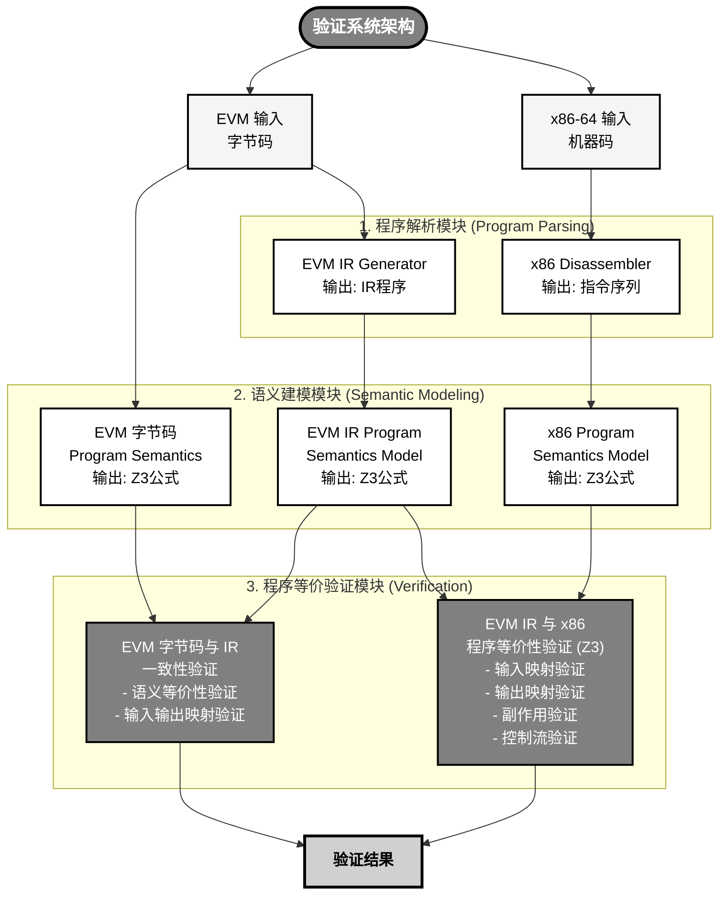

# EVM AOT形式化（黑盒）概要设计（新）

| 日期 | 变更人 | 变更原因 | 变更内容 |
| --- | --- | --- | --- |
| 2025-11-19 | 何奇 | 设计变更 | 1.创建文档<br>2.从分块验证改为整体程序验证 |

# 1 介绍

EVM AOT形式化（黑盒）是指将EVM AOT编译器作为黑盒对其进行形式化验证，其基本思路为Translate Validation，即对于特定的合约字节码，证明AOT编译器的编译结果的执行和直接解释合约字节码等价。此种证明方式可以证明EVM AOT编译器对于特定合约在所以输入以及状态下与EVM解释执行一致（无BUG）。

# 2 整体架构

对于接入区块链底层平台，整体方案如下：


整体流程如下：

1.  合约部署后，区块链节点会立即将该合约（或其元数据）作为验证任务 (Verification Task)，异步地发送至其关联的形式化验证服务 (Formal Verification Service)。
    
2.  形式化验证服务运行验证器，验证此合约经过EVM AOT编译器后是否与解释器执行等价。
    
3.  形式化验证服务将结果发送回节点，如果验证成功，合约后续调用均采用AOT方式执行；如果验证失败，则合约后续调用均采用默认的解释执行方式执行
    

说明点：

*   每个区块链节点都拥有一个独立的、自包含的验证服务实例
    
*   合约部署后，默认都是进入**解释执行模式** (Interpreter Execution Mode)，即如果区块链节点还**未收到验证服务的结果**，如果此时产生调用则均会运行解释执行
    

# 3 详细设计

## 3.1 整体流程设计


如图的整体流程如下：

构建阶段：

1.  EVM解释器建模 → 形式化建模：将EVM解释器的执行语义进行形式化定义
    
2.  X86-64指令建模 → 形式化建模：将X86-64指令集指令的执行语义进行形式化定义
    
3.  构建一致性验证框架：根据EVM解释器和X86-64指令集的形式化定义构建一致性验证框架
    

运行阶段：

1.  准备智能合约的合约字节码
    
2.  合约字节码经过AOT编译生成的x86-64代码
    
3.  执行一致性验证框架：将智能合约字节码、合约经过AOT编译生成的x86-64代码作为输入传入一致性验证框架
    
4.  验证框架调用Z3求解器进行约束求解和等价性检查
    
5.  最终输出两种实现语义是否一致的验证结果
    

## 3.2 验证框架设计

### 3.2.1 方案概述

**核心思想**

直接对整个程序进行语义等价性验证，即验证EVM字节码（或EVM IR）和对应的x86-64 AOT编译结果在整个程序级别上的语义等价性。这种方法：

*   简化验证架构，无需处理块分割和映射
    
*   从简单程序开始，逐步扩展到复杂程序
    
*   直接验证程序整体行为，避免块间连接问题
    
*   更适合作为初始验证方案，验证框架的正确性
    

**验证目标**

证明对于整个程序P：

```haskell
∀ inputs. EVM_Program_P(inputs) ≡ x86_Program_P(inputs)


```

即对于所有可能的输入状态，EVM程序和x86程序产生相同的输出状态（包括栈、内存、存储、Gas等）。

### 3.2.2 验证框架整体架构

1.  EVM IR生成，得到完整的EVM IR程序
    
2.  x86-64代码解析，得到完整的x86程序
    
3.  构建控制流图（CFG），识别所有执行路径
    
4.  对整个程序进行路径感知的语义建模和等价性验证
    



### 3.2.3 EVM IR程序生成

EVM IR生成依赖于AOT编译器前端，EVM AOT编译器前端将字节码变为EVM IR。本方案直接基于前端编译好的EVM IR进行验证，因此需要额外验证EVM 字节码 和 EVM IR的语义是否一致，也就是说需要单独证明EVM AOT编译器前端。见后续章节：[《形式化（黑盒）旧文档》](https://alidocs.dingtalk.com/i/nodes/7dx2rn0JbYArDnaLCqNmnM6nVMGjLRb3?utm_scene=team_space&iframeQuery=anchorId%3Duu_mhd74nvqtmct9wdcmw)

**实现要点：**

1.  **复用现有IR生成逻辑**
    
    *   直接使用`ir.CompileEVM()`生成的`CompilerEVMResult`
        
    *   获取完整的IR程序结构，包括所有Block和操作序列
        
    *   保留Block之间的控制流关系（跳转表、跳转目标等）
        
2.  **IR程序提取**
    
    *   从`CompilerEVMResult.ControlFrames`中提取所有Block及其操作序列
        
    *   构建完整的程序结构，包括入口点、跳转表等
        
    *   记录程序的元数据：总Gas消耗、栈深度范围等
        
3.  **数据格式转换**
    
    *   将Go的IR结构序列化为JSON格式
        
    *   供Python验证框架使用
        

### 3.2.4 x86-64代码解析

**目标：** 解析完整的x86-64机器码，获取指令序列和控制流信息。

**实现方案：**

1.  **反汇编x86代码**
    
    *   **使用capstone**反汇编库解析x86机器码
        
    *   获取完整的指令序列
        
    *   识别跳转指令和目标地址
        
2.  **控制流分析**
    
    *   构建x86程序的CFG（控制流图）
        
    *   识别入口点、基本块边界
        
    *   分析跳转表和间接跳转
        
3.  **程序结构提取**
    
    *   提取程序的整体结构信息
        
    *   识别CallEngine相关的内存访问模式
        
    *   为语义建模做准备
        

### 3.2.5 控制流图（CFG）构建与分析

**目标：** 为EVM IR程序和x86-64程序构建控制流图，识别所有执行路径，支持路径感知的语义建模和验证。

**CFG的作用：**

1.  **路径识别**
    
    *   识别程序中的所有执行路径（从入口到终端）
        
    *   为每条路径建立符号条件（用于路径合并）
        
    *   支持路径感知的语义建模
        
2.  **路径合并**
    
    *   在语义建模时，对每条路径分别建模，然后使用Z3的`If`表达式合并
        
    *   避免路径爆炸问题，同时保证验证的完整性
        
3.  **控制流验证**
    
    *   验证跳转目标的正确性
        
    *   验证所有可达路径都被覆盖
        

#### 3.2.5.1 EVM IR CFG构建

1.  **基本块识别**
    
    *   EVM IR程序已经以Block为单位组织
        
    *   每个Block对应一个基本块，包含一个TAG操作和一系列操作
        
    *   Block之间通过JUMP/JUMPI连接
        
2.  **跳转关系分析**
    
    *   **JUMP**：无条件跳转，从栈顶弹出目标地址（TAG参数）
        
    *   **JUMPI**：条件跳转，从栈顶弹出条件和目标地址
        
    *   **STOP/RETURN/REVERT**：终端块，无后继
        
    *   **其他操作**：顺序执行，跳转到下一个Block
        
3.  **CFG数据结构**
    
    ```python
    class IRCFG:
        blocks: List[EVMBlock]  # 所有基本块
        blocks_by_pc: Dict[int, EVMBlock]  # PC到块的映射
        successors: Dict[EVMBlock, List[EVMBlock]]  # 后继块关系
    
    ```
    
4.  **路径查找算法**
    
    *   使用深度优先搜索（DFS）查找所有从入口到终端的路径
        
    *   每条路径返回：`(path_blocks, path_condition)`
        
    *   `path_condition`：路径的符号条件（目前为True，后续可增强为JUMPI条件的组合）
        

#### 3.2.5.2 x86-64 CFG构建：

1.  **基本块识别**
    
    *   基本块边界：
        
        *   开始：程序入口、跳转目标、ret指令后的指令
            
        *   结束：jmp、条件跳转（jb/jae/je等）、ret
            
    *   使用`identify_basic_blocks()`函数识别基本块
        
2.  **跳转关系分析**
    
    *   **jmp**：无条件跳转，提取目标地址
        
    *   **条件跳转**（jb, jae, je, jne, jl, jle, jg, jge等）：
        
        *   跳转路径：目标地址（条件为真）
            
        *   顺序路径：下一条指令（条件为假）
            
    *   **ret**：返回，无后继
        
    *   **其他指令**：顺序执行
        
3.  **条件提取**
    
    *   对于条件跳转，从之前的CMP指令提取条件
        
    *   构建符号条件表达式（BoolRef）
        
    *   用于路径合并时的条件判断
        
4.  **CFG数据结构**
    
    ```python
    class X86CFG:
        blocks: List[X86Block]  # 所有基本块
        blocks_by_addr: Dict[int, X86Block]  # 地址到块的映射
        successors: Dict[X86Block, List[Tuple[X86Block, BoolRef]]]  # 后继块和条件
    
    ```
    
5.  **路径查找算法**
    
    *   使用DFS查找所有从入口到返回块的路径
        
    *   每条路径返回：`(path_blocks, path_condition)`
        
    *   `path_condition`：路径上所有跳转条件的合取（And）
        

#### 3.2.5.3 路径感知的语义建模：

1.  **两级路径合并（EVM IR）**
    
    *   **Level 1：Block级路径合并**
        
        *   每个Block内部可能有多条路径（例如Tag指令就至少有三条路径：栈检查、Gas检查、正常执行）
            
        *   在Block执行时进行路径合并
            
    *   **Level 2：CFG级路径合并**
        
        *   使用CFG找到所有Block级路径
            
        *   对每条CFG路径分别执行，然后使用`If`表达式合并结果
            
2.  **单级路径合并（x86-64）**
    
    *   使用CFG找到所有执行路径
        
    *   对每条路径分别执行，然后使用`If`表达式合并结果
        
3.  **路径合并实现**
    

```python
def _merge_path_results(path_results: List[Tuple[BoolRef, Dict]]):
    """使用嵌套If表达式合并路径结果"""
    # 对于每个字段，构建嵌套If表达式
    # If(condition1, result1, If(condition2, result2, ...))
    merged = {}
    for field in ['offset', 'length', 'memory', 'has_return']:
        expr = default_value
        for condition, result in reversed(path_results):
            expr = If(condition, result[field], expr)
        merged[field] = expr
    return merged

```

#### 3.2.5.4 循环处理

**循环检测：**

**循环处理：**

1.  循环展开（Loop Unrolling）
    

*   对于固定次数的循环，可以展开为有限次迭代，例如：`for (i = 0; i < 10; i++)` 可以展开为10次顺序执行
    
*   适用场景：循环次数在编译时或符号执行时可确定
    

1.  xxx
    
2.  兜底：gas作为次数，但可能Z3爆炸
    

// todo: 理论上循环可处理

### 3.2.6 EVM IR程序的逻辑语义建模

**目标：** 将整个EVM IR程序直接建模为Z3公式，建立从输入状态到输出状态的逻辑映射关系。这种方法类似于Alive2，不是逐步执行程序，而是直接将程序语义转换为逻辑公式。

**状态空间建模：**

EVM执行状态包含以下组件：

1.  **栈（Stack）**
    
    *   建模为数组：`Stack : Array[Int, BitVec[256]]`
        
    *   栈指针：`SP : Int`（范围：0到1024）
        
    *   栈顶元素：`Stack[SP-1]`，栈底元素：`Stack[0]`
        
2.  **内存（Memory）**
    
    *   建模为数组：`Memory : Array[BitVec[256], BitVec[8]]`
        
    *   内存大小：`MSize : BitVec[256]`（动态扩展）
        
3.  **存储（Storage）**
    
    *   建模为数组：`Storage : Array[BitVec[256], BitVec[256]]`
        
    *   键值对存储，256位地址到256位值
        
4.  **Gas**
    
    *   建模为：`Gas : BitVec[64]`
        
    *   静态Gas和动态Gas分别计算
        
5.  **程序计数器（PC）**
    
    *   建模为：`PC : Int`
        
    *   用于JUMP/JUMPI的目标地址
        
6.  **环境变量**
    
    *   `Caller`, `Address`, `Value`, `CallData`等
        
    *   建模为常量或符号变量
        

**EVM操作语义建模：**

每个EVM操作（`EvmOperator`）需要建模其语义：

```python
kind == "ADD":
        # ADD: pop two values, add them, push result
        # Using Z3 Array: value_b = Select(Stack, SP-1), value_a = Select(Stack, SP-2)
        # result = value_a + value_b
        # Stack' = Store(Stack, SP-2, result), SP' = SP - 1
```

**程序级语义建模：**

对于整个EVM IR程序，直接将其建模为Z3公式。给定输入状态，通过逻辑公式直接得到输出状态，而不是逐步执行：

```python
def model_evm_program(ir_program):
    """
    ir_program: EVM IR程序对象（包含所有Block和控制流信息）
    返回：Z3公式，表示从输入状态到输出状态的映射
    
    输入状态变量：
    - initial_stack: Array[Int, BitVec[256]]
    - initial_sp: Int
    - initial_memory: Array[BitVec[256], BitVec[8]]
    - initial_msize: BitVec[256]
    - initial_storage: Array[BitVec[256], BitVec[256]]
    - initial_gas: BitVec[64]
    
    输出状态变量：
    - final_stack: Array[Int, BitVec[256]]
    - final_sp: Int
    - final_memory: Array[BitVec[256], BitVec[8]]
    - final_msize: BitVec[256]
    - final_storage: Array[BitVec[256], BitVec[256]]
    - final_gas: BitVec[64]
    """
    # 定义输入状态变量
    initial_stack = Array('initial_stack', IntSort(), BitVecSort(256))
    initial_sp = Int('initial_sp')
    initial_memory = Array('initial_memory', BitVecSort(256), BitVecSort(8))
    initial_msize = BitVec('initial_msize', 256)
    initial_storage = Array('initial_storage', BitVecSort(256), BitVecSort(256))
    initial_gas = BitVec('initial_gas', 64)
    
    # 定义输出状态变量
    final_stack = Array('final_stack', IntSort(), BitVecSort(256))
    final_sp = Int('final_sp')
    final_memory = Array('final_memory', BitVecSort(256), BitVecSort(8))
    final_msize = BitVec('final_msize', 256)
    final_storage = Array('final_storage', BitVecSort(256), BitVecSort(256))
    final_gas = BitVec('final_gas', 64)
    
    # 构建逻辑公式：根据程序结构，直接建立输入到输出的映射关系
    # 对于控制流，使用If表达式或量词来处理所有可能的执行路径
    
    # 示例：对于线性程序（无跳转）
    # 直接顺序建模每个操作，建立状态转换公式
    
    # 示例：对于有条件跳转的程序
    # 使用If表达式：If(condition, model_path1, model_path2)
    
    # 返回输入输出状态之间的逻辑关系
    return {
        'input': {
            'stack': initial_stack,
            'sp': initial_sp,
            'memory': initial_memory,
            'msize': initial_msize,
            'storage': initial_storage,
            'gas': initial_gas,
        },
        'output': {
            'stack': final_stack,
            'sp': final_sp,
            'memory': final_memory,
            'msize': final_msize,
            'storage': final_storage,
            'gas': final_gas,
        },
        'formula': build_program_formula(ir_program, initial_state, final_state)
    }

def build_program_formula(ir_program, input_state, output_state):
    """
    构建程序的逻辑公式
    根据程序的控制流结构，直接建立输入到输出的映射
    """
    # 对于简单线性程序，直接顺序建模
    # 对于有控制流的程序，使用If表达式或量词
    pass


```

**实现要点：**

1.  **逻辑公式构建**
    
    *   使用Z3的`BitVec`类型表示256位整数
        
    *   使用`Array`类型表示栈、内存、存储
        
    *   使用`Int`类型表示栈指针等整数
        
    *   直接建立输入状态到输出状态的逻辑映射关系
        
2.  **控制流处理**
    
    *   对于线性程序：直接顺序建模每个操作
        
    *   对于条件跳转：使用`If(condition, path1, path2)`表达式
        
    *   对于循环：使用量词或有限展开
        
    *   对于间接跳转：使用跳转表建模
        
3.  **前提约束**
    
    *   栈深度约束：`0 <= SP <= 1024`
        
    *   内存扩展约束：`MSize >= 0`
        
    *   Gas约束：`Gas >= 0`
        
4.  **优化策略**
    
    *   对于常量值，直接计算而不使用符号变量
        
    *   对于已知范围的值，添加范围约束以加速求解
        
    *   使用Z3的简化器简化公式
        

### 3.2.7 x86-64语义建模

**目标：** 将整个x86-64程序直接建模为Z3公式，建立从输入状态到输出状态的逻辑映射关系。与EVM IR建模类似，不是逐步执行指令，而是直接将x86程序语义转换为逻辑公式。

**x86-64状态空间建模：**

1.  **寄存器**
    
    *   通用寄存器：`RAX, RBX, RCX, RDX, RSI, RDI, R8-R15`
        
    *   建模为：`Registers : Dict[str, BitVec[64]]`
        
    *   特殊寄存器：
        
        *   `R13`: CallEngine指针（`amd64ReservedRegisterForCallEngine`）
            
        *   `R14`: 栈基址指针地址（`amd64ReservedRegisterForStackBasePointerAddress`）
            
        *   `R15`: 内存指针（`amd64ReservedRegisterForMemory`）
            
2.  **内存**
    
    *   建模为：`Memory : Array[BitVec[64], BitVec[8]]`
        
    *   包括：
        
        *   EVM栈数据：`[CallEngine.stackBasePointer + offset]`
            
        *   EVM内存：`[R15 + offset]`
            
        *   CallEngine结构体字段
            
3.  **标志寄存器**
    
    *   `ZF, CF, SF, OF`等
        
    *   用于条件跳转
        
4.  **EVM状态抽象**
    
    *   通过CallEngine结构体访问EVM状态
        
    *   栈：`CallEngine.stackBasePointer + stack_offset`
        
    *   内存：`[R15 + offset]`
        
    *   Gas：`CallEngine.gas`
        
    *   栈指针：`CallEngine.stackPointer`
        
5.  **存储（Storage）等外部修改**
    
    *    **建模方式** ：通过Go运行时函数访问，建模为未解释函数（Uninterpreted Function）
        
    *   `Array('X86Storage', BitVecSort(256), BitVecSort(256))`
        
    *   Storage状态通过跟踪函数调用维护数组，可以直接提取Storage状态
        

**x86指令语义建模：**

需要建模的x86指令类型：

```python
    elif mnemonic == 'add':
        # ADD: add source to destination, set carry flag
        if not operands['dest_reg']:
            raise ValueError(f"ADD instruction must have register destination: {operands}")
        
        dest_reg = operands['dest_reg']
        reg_val = state.x86_registers.get_register(dest_reg)
        
        if operands['is_memory']:
            # ADD reg, [base+offset]
```

**程序级x86语义建模：**

对于整个x86程序，直接将其建模为Z3公式，类似于EVM IR的建模方式：

```python
def model_x86_program(x86_program):
    """
    x86_program: x86程序对象（包含指令序列和控制流信息）
    返回：Z3公式，表示从输入状态到输出状态的映射
    
    输入状态变量：
    - initial_registers: Dict[str, BitVec[64]]
    - initial_memory: Array[BitVec[64], BitVec[8]]
    - initial_flags: Dict[str, Bool]
    
    输出状态变量：
    - final_registers: Dict[str, BitVec[64]]
    - final_memory: Array[BitVec[64], BitVec[8]]
    - final_flags: Dict[str, Bool]
    
    同时需要提取EVM状态：
    - 从x86状态中提取EVM状态（栈、内存、Gas等）
    """
    # 定义输入状态变量
    initial_registers = {reg: BitVec(f'initial_{reg}', 64) for reg in x86_registers}
    initial_memory = Array('initial_memory', BitVecSort(64), BitVecSort(8))
    initial_flags = {flag: Bool(f'initial_{flag}') for flag in ['zf', 'cf', 'sf', 'of']}
    
    # 定义输出状态变量
    final_registers = {reg: BitVec(f'final_{reg}', 64) for reg in x86_registers}
    final_memory = Array('final_memory', BitVecSort(64), BitVecSort(8))
    final_flags = {flag: Bool(f'final_{flag}') for flag in ['zf', 'cf', 'sf', 'of']}
    
    # 构建逻辑公式：根据x86程序结构，直接建立输入到输出的映射关系
    # 对于控制流，使用If表达式来处理条件跳转
    
    # 返回输入输出状态之间的逻辑关系
    return {
        'input': {
            'registers': initial_registers,
            'memory': initial_memory,
            'flags': initial_flags,
        },
        'output': {
            'registers': final_registers,
            'memory': final_memory,
            'flags': final_flags,
        },
        'formula': build_x86_program_formula(x86_program, initial_state, final_state),
        'evm_state_extractor': build_evm_state_extractor(final_state)
    }

def build_x86_program_formula(x86_program, input_state, output_state):
    """
    构建x86程序的逻辑公式
    根据指令序列和控制流结构，直接建立输入到输出的映射
    """
    # 对于简单线性程序，直接顺序建模每个指令
    # 对于有控制流的程序，使用If表达式处理条件跳转
    pass

def build_evm_state_extractor(x86_final_state):
    """
    从x86最终状态中提取EVM状态的逻辑公式
    - 栈：从CallEngine.stackBasePointer指向的内存区域读取
    - 内存：从R15指向的内存区域读取
    - Gas：从CallEngine.gas读取
    """
    pass


```

**难点与解决方案：**

*   **难点1：间接内存访问**
    
    *   问题：x86指令可能通过寄存器间接访问内存，地址是符号值
        
    *   解决：使用Z3的`Array`类型和`Select`/`Store`操作建模，直接建立内存访问的逻辑公式
        
*   **难点2：控制流复杂**
    
    *   问题：x86代码中有条件跳转、循环、间接跳转等
        
    *   解决：使用If表达式建模条件跳转，对于循环使用量词或有限展开，对于间接跳转使用跳转表建模（处少数几个指令外，IR中包含循环，x86中才包含循环，可先实现不包含循环的，循环后续处理）
        
*   **难点3：调用Go函数**
    
    *   问题：`compileCallGoFunction`会调用Go运行时函数
        
    *   解决：将Go函数调用建模为黑盒函数，基于其语义建立逻辑公式（如`exitFromNativeCode`）
        
*   **难点4：寄存器分配不确定性**
    
    *   问题：编译器可能使用不同寄存器
        
    *   解决：基于数据流分析，只验证最终EVM状态，不关心中间寄存器分配
        
*   **难点5：公式复杂度**
    
    *   问题：复杂程序可能产生非常复杂的Z3公式，导致求解困难
        
    *   解决：从简单程序开始，逐步增加复杂度；使用公式简化技术；限制控制流复杂度
        

### 3.2.8 程序等价验证器

**目标：** 对于整个EVM IR程序和对应的x86程序，使用Z3证明它们在所有输入下产生相同的输出状态。验证方法类似于Alive2：将两个程序都建模为Z3公式，然后使用Z3证明公式等价性。

#### 3.2.8.1 验证目标具体定义

**验证目标定义如下：**

*   返回值一致性
    
*   执行完成后，内存状态一致性
    
*   执行完成后，栈状态一致性（可不检查）
    
*   Gas消耗一致性
    
*   外部修改一致性
    

1.  **返回值一致性** ：
    
    返回值一致性由两方面保证：return\_offset和return\_length + memory 一致性，memory都单独的步骤验证，因此此步骤验证return\_offset和return\_length一致性即可。
    
    ```python
    return_offset_equiv = evm_model['output']['return_offset'] == x86_model['output']['return_offset']
    return_length_equiv = evm_model['output']['return_length'] == x86_model['output']['return_length']
    return_equiv = And(return_offset_equiv, return_length_equiv)
    
    ```
    
2.  **执行完成后，内存状态一致性** ：
    

验证目标：对于所有已访问的内存地址，EVM内存和x86内存中对应位置的字节值相等。

**验证关系：**

```python
ForAll addr. (0 <= addr < max(evm_msize, x86_msize)) =>
    evm_memory[addr] == x86_memory[x86_base_addr + addr]

```

其中：

*   `evm_memory`: EVM内存数组 `Array[BitVec[64], BitVec[8]]`
    
*   `x86_memory`: x86内存数组 `Array[BitVec[64], BitVec[8]]`
    
*   `evm_msize`: EVM内存大小（已访问的最大地址+1），可以是符号变量或符号表达式
    
*   `x86_base_addr`: x86内存基址（R15寄存器值），EVM内存在x86内存中的起始地址
    
*   地址映射关系：EVM地址`addr`对应x86地址`R15 + addr`
    

验证方法（使用反证法，避免量词）：

**关键点说明：**

1.  **MSize可以是符号变量**，Z3可处理
    
2.  **地址映射关系**：
    
    *   EVM内存地址：`evm_memory[addr]`
        
    *   x86内存地址：`x86_memory[x86_base_addr + addr]`
        
    *   其中`x86_base_addr = R15`（EVM内存在x86内存中的基址）
        
3.  **验证范围**：
    
    *   只验证已访问的内存区域：`0 <= addr < max(evm_msize, x86_msize)`
        
    *   避免验证整个64位地址空间，提高性能
        
    *   可以添加上界约束：`solver.add(evm_msize <= BitVecVal(1024, 64))`限制验证范围
        
4.  **反证法优势**：
    
    *   避免使用`ForAll`量词，提高求解效率
        
    *   检查是否存在反例，而不是验证所有情况
        
    *   Z3对存在性检查（`Exists`）比全称量词（`ForAll`）更高效
        
5.  **性能优化建议**：
    
    *   限制验证范围：添加MSize上界约束
        
    *   分段验证：对于大范围内存，可以分段验证
        
    *   只验证相关区域：如果只关心返回数据区域，可以只验证该区域
        

3.  **Gas消耗一致性** 直接验证即可。
    
    ```python
    gas_equiv = evm_model['output']['gas'] == x86_model['output']['gas']
    
    ```
    
4.  **外部修改一致性**
    

外部修改一致性通过验证storage一致性。

使用反证法，可通过限制验证范围优化，即记录并直接验证被访问的key是否一致。

```python
storage_equiv = build_storage_equivalence(
    evm_model['output']['storage'],
    evm_output_from_x86['storage']
)

def build_storage_equivalence(evm_storage, x86_storage):
    """构建Storage等价性公式"""
    # 验证已访问的Storage区域
    storage_equiv = True
    # 使用有限范围验证（避免量词）
    # 实际实现中可能需要限制验证范围
    return storage_equiv

```

#### 3.2.8.2 验证框架

```python
def verify_program_equivalence(evm_program, x86_program):
    """
    验证EVM程序和x86程序的语义等价性
    
    方法：
    1. 将EVM程序建模为Z3公式：F_evm(input) -> output_evm
    2. 将x86程序建模为Z3公式：F_x86(input) -> output_x86
    3. 从x86输出中提取EVM状态：extract_evm_state(output_x86) -> output_evm_from_x86
    4. 使用Z3证明：∀input. output_evm == output_evm_from_x86
    """
    # 1. 将EVM程序建模为Z3公式
    evm_model = model_evm_program(evm_program)
    # evm_model包含：
    # - input: 输入状态变量
    # - output: 输出状态变量
    # - formula: 输入到输出的逻辑公式
    
    # 2. 将x86程序建模为Z3公式
    x86_model = model_x86_program(x86_program)
    # x86_model包含：
    # - input: 输入状态变量（x86寄存器、内存等）
    # - output: 输出状态变量
    # - formula: 输入到输出的逻辑公式
    # - evm_state_extractor: 从x86输出提取EVM状态的公式
    
    # 3. 建立输入状态的对应关系
    # 将EVM输入状态映射到x86输入状态
    x86_input_from_evm = map_evm_to_x86_input(evm_model['input'])
    
    # 4. 从x86输出中提取EVM状态
    evm_output_from_x86 = x86_model['evm_state_extractor'](
        x86_model['output'],
        x86_input_from_evm
    )
    
    # 5. 构建等价性约束
    # 对于所有输入，EVM输出和x86提取的EVM输出应该相等
    stack_equiv = build_stack_equivalence(
        evm_model['output']['stack'],
        evm_model['output']['sp'],
        evm_output_from_x86['stack'],
        evm_output_from_x86['sp']
    )
    
    memory_equiv = build_memory_equivalence(
        evm_model['output']['memory'],
        evm_model['output']['msize'],
        evm_output_from_x86['memory'],
        evm_output_from_x86['msize']
    )
    
    gas_equiv = evm_model['output']['gas'] == evm_output_from_x86['gas']
    
    storage_equiv = build_storage_equivalence(
        evm_model['output']['storage'],
        evm_output_from_x86['storage']
    )
    
    # 6. 添加前提约束
    preconditions = [
        0 <= evm_model['input']['sp'],
        evm_model['input']['sp'] <= 1024,
        evm_model['input']['gas'] >= 0,
        evm_model['input']['msize'] >= 0,
    ]
    
    # 7. 使用Z3证明等价性
    # 证明：∀input. (preconditions -> (stack_equiv ∧ memory_equiv ∧ gas_equiv ∧ storage_equiv))
    # 等价于证明：¬(preconditions -> (stack_equiv ∧ ...)) 不可满足
    solver = Solver()
    solver.add(preconditions)
    solver.add(evm_model['formula'])  # EVM程序的逻辑公式
    solver.add(x86_model['formula'])  # x86程序的逻辑公式
    solver.add(map_evm_to_x86_input_formula(evm_model['input'], x86_input_from_evm))
    
    # 添加不等价的假设，如果不可满足则说明等价
    solver.add(Not(And(stack_equiv, memory_equiv, gas_equiv, storage_equiv)))
    
    result = solver.check()
    if result == unsat:
        return True  # 等价：找不到反例
    else:
        model = solver.model()
        return False, model  # 找到反例：存在输入使得输出不等价

def build_stack_equivalence(evm_stack, evm_sp, x86_stack, x86_sp):
    """构建栈等价性公式"""
    # 对于所有栈位置i，如果i < min(evm_sp, x86_sp)，则栈值相等
    max_sp = If(evm_sp > x86_sp, evm_sp, x86_sp)
    stack_equiv = True
    # 使用量词或有限范围验证
    for i in range(1024):  # 或使用量词
        stack_equiv = And(stack_equiv,
            If(i < evm_sp,
               If(i < x86_sp,
                  Select(evm_stack, i) == Select(x86_stack, i),
                  True),  # x86栈更短，只验证x86栈范围内的
               True))  # evm栈更短，跳过
    return stack_equiv

def build_memory_equivalence(evm_memory, evm_msize, x86_memory, x86_msize):
    """构建内存等价性公式"""
    # 验证已访问的内存区域
    max_msize = If(evm_msize > x86_msize, evm_msize, x86_msize)
    memory_equiv = True
    # 使用有限范围验证（避免量词）
    # 实际实现中可能需要限制验证范围
    return memory_equiv


```

**验证原理（类似Alive2）：**

1.  **公式建模**
    
    *   EVM程序 → Z3公式 F\_evm(input) = output\_evm
        
    *   x86程序 → Z3公式 F\_x86(input) = output\_x86
        
    *   从x86输出提取EVM状态 → extract\_evm(output\_x86) = output\_evm\_from\_x86
        
2.  **等价性证明**
    
    *   使用Z3证明：∀input. (preconditions → output\_evm == output\_evm\_from\_x86)
        
    *   如果Z3返回unsat，说明在所有满足前提条件的输入下，两个程序输出等价
        
    *   如果Z3返回sat，说明找到反例，两个程序不等价
        
3.  **优势**
    
    *   不需要逐步执行程序，直接使用逻辑公式
        
    *   可以处理所有可能的输入，而不仅仅是具体值
        
    *   利用Z3的强大求解能力
        

**优化策略：**

1.  **从简单程序开始**
    
    *   先验证无跳转的线性程序
        
    *   再验证简单的条件跳转程序
        
    *   逐步增加复杂度
        
2.  **公式简化**
    
    *   对于常量值，直接计算
        
    *   对于已知范围，添加范围约束
        
    *   使用Z3的简化器简化公式
        
3.  **状态抽象**
    
    *   只验证相关的EVM状态组件
        
    *   对于未修改的组件，跳过验证
        
4.  **分阶段验证**
    
    *   先验返回结果
        
    *   再验证内存操作
        
    *   最后验证gas和外部修改
        
5.  **超时机制**
    
    *   设置验证超时时间
        
    *   超时的程序标记为"需要人工审查"
        

## 3.3 关键点说明

### 3.3.1 EVM字节码与 EVM IR块语义的一致性证明（待设计，其实也可以使用Isabelle的证明？）

需要保证字节码序列到块序列的语义一致性（如何保证）

ByteCode -> IR Block 的翻译验证

语义建模       IR Block List  ( 跳转表 )

（可以先整个翻译验证）

1.  扣静态gas -> X
    
2.  扣动态gas -> Y
    
3.  执行 -> Y
    

## 3.4 关键技术难点与解决方案

### 3.4.1 难点1：EVM状态到x86状态的映射

**问题描述：**

*   EVM状态（栈、内存、存储）在x86中通过CallEngine结构体访问
    
*   需要理解CallEngine的内存布局和字段偏移
    
*   寄存器分配的不确定性使得状态提取复杂
    

**解决方案：**

1.  **CallEngine结构体分析**
    
    *   分析Go代码中的CallEngine结构体定义
        
    *   确定每个字段的偏移量
        
    *   建立字段到EVM状态的映射关系
        
2.  **状态抽象层**
    
    *   在x86语义建模中，抽象出EVM状态访问接口
        
    *   通过CallEngine指针访问EVM状态
        
    *   隐藏寄存器分配细节
        
3.  **数据流分析**
    
    *   跟踪EVM状态在x86代码中的流动
        
    *   识别状态读写的关键指令
        
    *   验证状态转换的正确性
        

**实施建议：**

*   先实现CallEngine结构体的完整定义文档
    
*   编写状态提取的测试用例，验证正确性
    

### 3.4.2 难点2：动态Gas计算的一致性

**问题描述：**

*   EVM的Gas计算包含静态Gas和动态Gas
    
*   动态Gas依赖于实际执行路径（如内存扩展、存储操作）
    
*   x86代码中的Gas计算必须与EVM语义一致
    

**解决方案：**

1.  **Gas计算分离**
    
    *   静态Gas：在TAG处扣减，验证相对简单
        
    *   动态Gas：在具体操作处计算，需要详细验证
        
2.  **Gas计算语义建模**
    
    *   为每个EVM操作建模其Gas计算逻辑
        
    *   在x86代码中识别Gas计算指令
        
    *   验证两者的一致性
        
3.  **Gas验证策略**
    
    *   对于简单操作，验证Gas计算表达式
        
    *   对于复杂操作（如CALL），先验证功能正确性，Gas作为辅助验证
        

**实施建议：**

*   先实现静态Gas的验证
    
*   动态Gas作为第二阶段目标
    
*   对于Gas计算不一致但功能正确的情况，可以标记为警告
    

### 3.4.3 难点3：间接跳转和跳转表

**问题描述：**

*   EVM的JUMP指令目标地址在栈上，是动态值
    
*   x86使用跳转表实现间接跳转
    
*   需要验证跳转表的结构和跳转逻辑的正确性
    

**解决方案：**

1.  **跳转表识别**
    
    *   在x86代码中识别跳转表结构
        
    *   解析跳转表的内容（目标地址列表）
        
    *   建立跳转表到EVM Block的映射
        
2.  **跳转目标验证**
    
    *   对于静态跳转（JUMP的目标是常量），直接验证
        
    *   对于动态跳转，验证跳转表覆盖所有可能的跳转目标
        
    *   验证跳转边界检查（防止跳转到无效地址）
        
3.  **符号执行辅助**
    
    *   使用符号执行确定JUMP的可能目标
        
    *   验证这些目标都在跳转表中
        
    *   验证跳转表的完整性
        

**实施建议：**

*   先支持静态跳转的验证
    
*   动态跳转作为高级功能实现
    
*   使用符号执行工具辅助跳转目标分析
    

### 3.4.4 难点4：Go函数调用的建模

**问题描述：**

*   x86代码中会调用Go运行时函数（如`compileCallGoFunction`）
    
*   这些函数的实现是黑盒的
    
*   需要基于函数语义进行建模
    

**解决方案：**

1.  **函数语义分析**
    
    *   分析每个Go函数的语义（输入、输出、副作用）
        
    *   建立函数语义的Z3模型
        
    *   对于复杂函数，使用简化模型
        
2.  **函数分类**
    
    *   **纯函数**：只读EVM状态，无副作用（如`getBalance`）
        
    *   **状态修改函数**：修改EVM状态（如`setStorage`）
        
    *   **控制流函数**：改变执行流程（如`exitFromNativeCode`）
        
3.  **黑盒建模**
    

```python
def model_go_function(func_name, args, state):
    """基于函数语义建模"""
    if func_name == 'exitFromNativeCode':
        # 设置退出状态，返回
        return exit_state
    elif func_name == 'callGoFunction':
        # 调用外部函数，返回结果
        return call_result


```

**实施建议：**

*   列出所有涉及的Go函数
    
*   为每个函数编写语义文档
    
*   实现函数语义的Z3模型
    

### 3.4.5 难点5：循环的处理

## 3.5 风险与应对

### 3.5.1 技术风险

1.  **Z3求解器性能问题**
    
    *   风险：复杂程序验证超时或内存不足
        
    *   应对：实现超时机制，优化约束生成，限制路径深度，必要时使用简化模型
        
2.  **x86语义建模不完整**
    
    *   风险：某些x86指令未建模
        
    *   应对：逐步完善指令集支持，建立指令覆盖测试
        
3.  **公式复杂度问题**
    
    *   风险：复杂程序产生的Z3公式过于复杂，导致验证超时或不可行
        
    *   应对：从简单程序开始，实现公式简化，限制控制流复杂度，使用公式优化技术
        
4.  **状态空间爆炸**
    
    *   风险：内存操作导致状态空间过大
        
    *   应对：使用状态抽象，限制内存验证范围，只验证相关内存区域
        

### 3.5.2 工程风险

1.  **开发周期延长**
    
    *   风险：难点比预期复杂
        
    *   应对：分阶段实施，优先实现核心功能
        
2.  **维护成本高**
    
    *   风险：代码复杂，难以维护
        
    *   应对：编写详细文档，模块化设计，充分测试
        

### 3.5.3 验证准确性风险

1.  **建模错误**
    
    *   风险：语义建模不正确
        
    *   应对：充分测试，与解释器对比，人工审查
        
2.  **遗漏验证**
    
    *   风险：某些控制流路径未在公式中建模
        
    *   应对：建立控制流覆盖检查，确保所有可达路径都在公式中；记录未建模路径的原因
        
3.  **公式建模错误**
    
    *   风险：逻辑公式建模不正确，导致验证结果错误
        
    *   应对：充分测试公式建模逻辑，与解释器对比验证结果；使用简单程序验证公式正确性
        

## 3.6 技术选型

*   **Python + Z3**
    
    **优势：**
    
    *   Z3 集成成熟
        
    *   开发效率高，原型快
        
    *   生态丰富（测试、序列化）
        
    *   JSON/Protobuf 序列化方便与 Go 互操作
        
        **劣势：**
        
    *   性能：符号表达式构建慢，大块可能慢
        
    *   类型安全：依赖类型注解，运行时检查
        
    *   可维护性：复杂项目需更多测试
        
*   **K Framework**
    
    **优势：**
    
    *   形式化语义：可直接定义 EVM 语义规则
        
    *   自动工具生成：证明器、符号执行器
        
    *   数学严谨性：语义定义即规范
        
    *   与 KEVM 可复用
        
        **劣势：**
        
    *   学习曲线陡
        
    *   性能：编译与执行可能较慢
        
    *   调试困难
        
    *   集成：需要与 x86 语义独立实现或桥接
        
*   **Golang + Z3**
    
    **优势：**
    
    *   与编译器同语言，可直接复用 IR 结构
        
    *   性能：编译型，执行更快
        
    *   类型安全：编译期检查
        
    *   内存效率：适合大规模
        
        **劣势：**
        
    *   Z3 绑定较弱
        
    *   符号执行支持不足：Z3 Go binding 不成熟，需要 CGO/C API 包装
        
    *   开发效率相对较低
        


结论：选择 Python + Z3