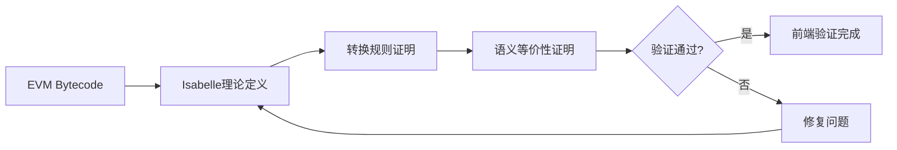

# 前端形式化验证设计

> 本文档是《EVM AOT形式化概要设计》的子文档，详细描述编译器前端形式化验证的设计方案。

| 版本 | 日期 | 变更人员 | 变更原因 | 变更内容 | 备注 |
| --- | --- | --- | --- | --- | --- |
| 1.0 | 2025-11-19 | 何奇 | 创建文档 | 1. 创建文档 |  |

# 1 概述

编译器前端负责将EVM Bytecode转换为EVM IR。前端验证采用Isabelle进行完全白盒验证，深入编译器实现细节，证明转换的正确性。

## 1.1 验证目标

前端验证的主要目标是：

1.  **语义保持性证明**：证明EVM Bytecode到EVM IR的转换保持语义不变
    
2.  **转换规则正确性**：证明前端编译器的转换规则是正确的
    
3.  **完整性验证**：验证所有EVM Bytecode指令都能正确转换为EVM IR
    

**形式化目标：**

对于任意EVM Bytecode程序 `P_bytecode` 和其对应的EVM IR程序 `P_ir`，证明：

```haskell
∀ inputs. semantics_bytecode(P_bytecode, inputs) = semantics_ir(P_ir, inputs)

```

即对于所有可能的输入状态，EVM Bytecode和EVM IR产生相同的执行结果。

## 1.2 验证方法

前端验证采用Isabelle形式化证明方法，通过以下步骤实现：

1.  **指令级语义建模**：在Isabelle中定义EVM Bytecode和EVM IR的语义
    
2.  **转换规则证明**：证明前端转换规则的正确性
    
3.  **语义保持性证明**：证明转换前后语义等价
    

# 2 Isabelle理论定义

在Isabelle中需要定义以下理论：

## 2.1 EVM Bytecode语义定义

```isabelle
theory EVM_Bytecode_Semantics
  imports Main
begin

(* EVM Bytecode指令类型 *)
datatype evm_opcode = 
  STOP | ADD | MUL | SUB | DIV | MOD
  | PUSH nat int  (* PUSH指令：字节数 + 立即数 *)
  | POP | MLOAD | MSTORE
  | JUMP | JUMPI | JUMPDEST
  | RETURN | REVERT
  (* ... 其他指令 *)

(* EVM执行状态 *)
record evm_state = 
  stack :: "int256 list"
  memory :: "nat ⇒ int8"
  storage :: "int256 ⇒ int256"
  pc :: nat
  gas :: nat

(* EVM Bytecode指令语义 *)
fun evm_step :: "evm_opcode ⇒ evm_state ⇒ evm_state option" where
  "evm_step STOP s = None" |
  "evm_step (ADD) s = 
    (case stack s of
      a # b # xs ⇒ Some (s⦇stack := (a + b) mod 2^256 # xs⦈)
    | _ ⇒ None)" |
  (* ... 其他指令的语义定义 *)

(* EVM Bytecode程序语义 *)
fun evm_execute :: "evm_opcode list ⇒ evm_state ⇒ evm_state option" where

  "evm_execute [ ] s = Some s" |

  "evm_execute (op # ops) s = 
    (case evm_step op s of
      None ⇒ None
    | Some s' ⇒ evm_execute ops s')"

end


```

## 2.2 EVM IR语义定义

```isabelle
theory EVM_IR_Semantics
  imports Main
begin

(* EVM IR操作类型 *)
datatype ir_operator = 
  TAG nat nat nat  (* TAG: pc, min_depth, max_depth *)
  | ADD | MUL | SUB | DIV | MOD
  | PUSH int256
  | POP | MLOAD | MSTORE
  | JUMP | JUMPI
  | RETURN | REVERT | STOP
  | BLOCKEND

(* EVM IR Block *)
record ir_block = 
  pc :: nat
  min_depth :: nat
  max_depth :: nat
  operations :: "ir_operator list"

(* EVM IR执行状态（与EVM Bytecode状态相同） *)
type_synonym ir_state = evm_state

(* EVM IR操作语义 *)
fun ir_step :: "ir_operator ⇒ ir_state ⇒ ir_state option" where
  "ir_step (TAG _ _ _) s = Some s" |
  "ir_step (ADD) s = 
    (case stack s of
      a # b # xs ⇒ Some (s⦇stack := (a + b) mod 2^256 # xs⦈)
    | _ ⇒ None)" |
  (* ... 其他操作的语义定义 *)

(* EVM IR Block语义 *)
fun ir_execute_block :: "ir_block ⇒ ir_state ⇒ ir_state option" where
  "ir_execute_block block s = 
    (if min_depth block ≤ length (stack s) ∧ length (stack s) ≤ max_depth block
     then foldl (λs op. case s of None ⇒ None | Some s' ⇒ ir_step op s') (Some s) (operations block)
     else None)"

end


```

## 2.3 前端转换规则定义

```isabelle
theory Frontend_Translation
  imports EVM_Bytecode_Semantics EVM_IR_Semantics
begin

(* 前端转换函数：EVM Bytecode → EVM IR *)
fun frontend_translate :: "evm_opcode list ⇒ ir_block list" where

  "frontend_translate [ ] = [ ]" |

  "frontend_translate ops = 
    (* 转换规则：将EVM Bytecode指令序列转换为EVM IR Block序列 *)
    (* 具体实现依赖于前端编译器的转换规则 *)
    translate_blocks ops"

(* 转换规则正确性定理 *)
theorem frontend_translation_correctness:
  "∀ bytecode ir_state.
    let ir_blocks = frontend_translate bytecode in
    (case evm_execute bytecode ir_state of
      None ⇒ (∀ block ∈ set ir_blocks. ir_execute_block block ir_state = None)
    | Some final_state ⇒ 
        ∃ execution_path. 
          foldl (λs block. case s of None ⇒ None | Some s' ⇒ ir_execute_block block s') 
                (Some ir_state) execution_path = Some final_state ∧
          set execution_path ⊆ set ir_blocks)"
  (* 证明：通过结构归纳和案例分析 *)
  sorry

end


```

## 2.4 语义等价性定理

```isabelle
theorem frontend_semantic_equivalence:
  "∀ bytecode inputs.
    let ir_blocks = frontend_translate bytecode in
    semantics_bytecode(bytecode, inputs) = semantics_ir(ir_blocks, inputs)"
  (* 证明：基于frontend_translation_correctness定理 *)
  by (simp add: frontend_translation_correctness)


```

# 3 验证方法

前端验证采用以下方法：

## 3.1 指令级语义建模

1.  **EVM Bytecode指令语义建模**：
    
    *   在Isabelle中定义每个EVM Bytecode指令的语义
        
    *   使用函数式风格定义状态转换
        
    *   处理异常情况（栈下溢、gas耗尽等）
        
2.  **EVM IR操作语义建模**：
    
    *   在Isabelle中定义每个EVM IR操作的语义
        
    *   特别处理TAG操作的栈深度检查语义
        
    *   定义Block的执行语义
        

## 3.2 转换规则证明

1.  **指令转换规则**：
    
    *   证明每个EVM Bytecode指令如何转换为EVM IR操作
        
    *   例如：`PUSH n imm` → `TAG(pc, min_depth, max_depth)` + `PUSH imm`
        
    *   证明转换后的语义等价
        
2.  **Block构建规则**：
    
    *   证明如何将EVM Bytecode指令序列组织成EVM IR Block
        
    *   证明Block的min\_depth和max\_depth计算正确性
        
    *   证明Block边界划分的正确性
        

## 3.3 语义保持性证明

1.  **状态等价性**：
    
    *   证明转换前后执行状态的结构等价
        
    *   证明栈、内存、存储等状态的对应关系
        
2.  **执行路径等价性**：
    
    *   证明EVM Bytecode的执行路径与EVM IR的执行路径对应
        
    *   处理控制流转换（JUMP → Block跳转）
        
3.  **终止性证明**：
    
    *   证明转换前后程序的终止性一致
        
    *   证明异常情况的处理一致
        

# 4 验证工具链

前端验证使用以下工具：

*   **Isabelle/HOL**：形式化证明系统
    
*   **Isabelle/ML**：用于实现转换规则的可执行版本
    
*   **Isabelle/Code\_Generation**：生成可执行的验证代码
    

# 5 验证流程

前端验证流程如下：



**步骤说明：**

1.  **输入**：EVM Bytecode程序
    
2.  **理论定义**：在Isabelle中定义EVM Bytecode和EVM IR的语义
    
3.  **转换规则证明**：证明前端转换规则的正确性
    
4.  **语义等价性证明**：证明转换前后语义等价
    
5.  **验证结果**：如果证明通过，前端验证完成；否则需要修复问题并重新验证
    

# 6 数据结构设计

## 6.1 EVM Bytecode数据结构

EVM Bytecode是原始的以太坊字节码，采用字节序列表示。

```python
class EVMBytecode:
    """EVM Bytecode数据结构"""
    
    def __init__(self, bytecode: bytes):
        """初始化EVM Bytecode
        
        Args:
            bytecode: 字节码序列
        """
        self.bytecode = bytecode
        self.length = len(bytecode)
    
    def get_opcode(self, pc: int) -> Optional[EVMOpcode]:
        """获取指定PC位置的指令
        
        Args:
            pc: 程序计数器值
            
        Returns:
            EVM指令对象，如果PC超出范围返回None
        """
        if pc >= self.length:
            return None
        opcode_byte = self.bytecode[pc]
        return EVMOpcode.from_byte(opcode_byte, pc, self.bytecode)


```

## 6.2 EVM IR数据结构

EVM IR是前端编译后的中间表示，采用Block结构组织。

```python
class EVMBlock:
    """EVM IR Block数据结构"""
    
    def __init__(self, pc: int, min_depth: int, max_depth: int, operations: List[EvmOperator]):
        """初始化EVM Block
        
        Args:
            pc: Block的程序计数器值
            min_depth: 最小栈深度
            max_depth: 最大栈深度
            operations: Block内的操作列表
        """
        self.pc = pc
        self.min_depth = min_depth
        self.max_depth = max_depth
        self.operations = operations

class EvmOperator:
    """EVM IR操作数据结构"""
    
    def __init__(self, kind: str, pc: int, immediate: Optional[int] = None, param: Optional[int] = None):
        """初始化EVM操作
        
        Args:
            kind: 操作类型（TAG, ADD, JUMP, JUMPI等）
            pc: 操作的程序计数器值
            immediate: 立即数（用于PUSH等指令）
            param: 参数（用于PUSH等指令）
        """
        self.kind = kind
        self.pc = pc
        self.immediate = immediate
        self.param = param


```

# 7 实施计划

## 7.1 阶段一：理论基础建设（2-3个月）

1.  **EVM Bytecode语义定义**（1个月）
    
    *   在Isabelle中定义EVM Bytecode指令类型
        
    *   定义EVM执行状态（栈、内存、存储等）
        
    *   实现所有EVM指令的语义函数
        
    *   验证语义定义的完整性和正确性
        
2.  **EVM IR语义定义**（1个月）
    
    *   在Isabelle中定义EVM IR操作类型
        
    *   定义EVM IR Block结构
        
    *   实现所有IR操作的语义函数
        
    *   特别处理TAG操作的语义
        
3.  **转换规则定义**（1个月）
    
    *   定义前端转换函数
        
    *   实现指令级转换规则
        
    *   实现Block构建规则
        
    *   验证转换规则的完整性
        

## 7.2 阶段二：证明开发（3-4个月）

1.  **语义保持性证明**（2个月）
    
    *   证明指令级转换的语义保持性
        
    *   证明Block构建的语义保持性
        
    *   证明状态结构的对应关系
        
2.  **转换规则正确性证明**（2个月）
    
    *   证明每个转换规则的正确性
        
    *   处理边界情况和异常情况
        
    *   验证转换的完整性
        

## 7.3 阶段三：验证工具开发（1-2个月）

1.  **可执行验证代码生成**（1个月）
    
    *   使用Isabelle代码生成功能
        
    *   生成可执行的验证代码
        
    *   集成到验证框架中
        
2.  **测试和优化**（1个月）
    
    *   使用实际合约进行测试
        
    *   优化证明性能
        
    *   完善错误报告
        

# 8 测试策略

## 8.1 单元测试

1.  **前端验证测试**：
    
    *   测试单个指令的转换
        
    *   测试简单程序的转换
        
    *   测试边界情况
        

## 8.2 集成测试

1.  **端到端验证测试**：
    
    *   使用实际智能合约进行完整验证
        
    *   验证前端转换的完整流程
        
    *   测试各种合约类型（简单合约、复杂合约）
        

## 8.3 回归测试

1.  **测试用例库**：
    
    *   建立标准测试用例库
        
    *   包含各种类型的合约
        
    *   定期运行回归测试
        
2.  **持续集成**：
    
    *   集成到CI/CD流程
        
    *   自动运行验证测试
        
    *   及时发现回归问题
        

## 8.4 验证覆盖率

1.  **指令覆盖率**：
    
    *   确保所有EVM指令都有测试用例
        
    *   跟踪覆盖率指标