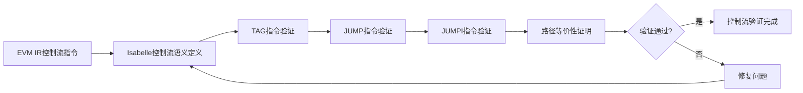
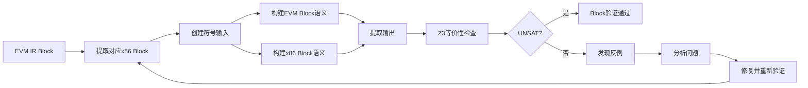

# 后端形式化验证设计

> 本文档是《EVM AOT形式化概要设计》的子文档，详细描述编译器后端形式化验证的设计方案。

| 版本 | 日期 | 变更人员 | 变更原因 | 变更内容 | 备注 |
| --- | --- | --- | --- | --- | --- |
| 1.0 | 2025-11-19 | 何奇 | 创建文档 | 1. 创建文档 |  |

# 1 概述

编译器后端负责将EVM IR转换为x86-64机器码。后端验证采用混合策略：控制流部分使用Isabelle白盒验证，Block语义部分使用Z3黑盒验证。

## 1.1 验证策略

后端验证分为两个层次：

1.  **后端控制流验证（Isabelle白盒）**：
    
    *   验证TAG、JUMP、JUMPI等控制流指令的语义等价性
        
    *   使用Isabelle进行控制流语义证明
        
2.  **后端Block验证（Z3黑盒）**：
    
    *   以Block为粒度验证EVM IR Block与x86 Block的语义等价性
        
    *   使用Z3求解器进行符号执行和等价性检查
        
    *   不依赖CFG，独立验证每个Block
        

# 2 后端控制流验证（Isabelle白盒）

后端控制流验证专注于验证TAG、JUMP、JUMPI等控制流指令的转换正确性。

## 2.1 验证目标

1.  **控制流语义等价性**：证明EVM IR控制流指令与x86-64控制流指令的语义等价
    
2.  **跳转目标正确性**：证明JUMP/JUMPI的跳转目标在x86代码中正确实现
    
3.  **路径条件等价性**：证明条件跳转（JUMPI）的条件判断在x86代码中正确实现
    

**形式化目标：**

对于EVM IR控制流指令序列和对应的x86-64控制流指令序列，证明：

```haskell
∀ state. control_flow_semantics_ir(ir_control_flow, state) = 
         control_flow_semantics_x86(x86_control_flow, state)

```

## 2.2 Isabelle理论定义

```isabelle
theory Backend_Control_Flow_Verification
  imports EVM_IR_Semantics X86_Semantics
begin

(* EVM IR控制流指令 *)
datatype ir_control_flow = 
  TAG nat nat nat  (* pc, min_depth, max_depth *)
  | JUMP           (* 无条件跳转 *)
  | JUMPI          (* 条件跳转 *)

(* x86-64控制流指令 *)
datatype x86_control_flow = 
  LABEL nat        (* 标签，对应TAG *)
  | JMP nat        (* 无条件跳转 *)
  | Jcc "x86_condition" nat  (* 条件跳转 *)

(* 控制流转换函数 *)
fun backend_translate_control_flow :: 
  "ir_control_flow list ⇒ x86_control_flow list" where

  "backend_translate_control_flow [ ] = [ ]" |

  "backend_translate_control_flow (TAG pc min max # rest) = 
    LABEL pc # backend_translate_control_flow rest" |
  "backend_translate_control_flow (JUMP # rest) = 
    JMP target # backend_translate_control_flow rest" |
  "backend_translate_control_flow (JUMPI # rest) = 
    Jcc condition target # backend_translate_control_flow rest"

(* 控制流语义等价性定理 *)
theorem control_flow_equivalence:
  "∀ ir_cf x86_cf state.
    x86_cf = backend_translate_control_flow ir_cf ⟶
    control_flow_semantics_ir(ir_cf, state) = 
    control_flow_semantics_x86(x86_cf, state)"
  (* 证明：通过案例分析每个控制流指令 *)
  sorry

end


```

## 2.3 验证方法

1.  **TAG指令验证**：
    
    *   证明TAG指令转换为x86标签（LABEL）的正确性
        
    *   证明栈深度检查在x86代码中的实现正确性
        
    *   验证min\_depth和max\_depth的检查逻辑
        
2.  **JUMP指令验证**：
    
    *   证明JUMP指令转换为x86 JMP指令的正确性
        
    *   证明跳转目标地址计算的正确性
        
    *   验证无条件跳转的语义一致性
        
3.  **JUMPI指令验证**：
    
    *   证明JUMPI指令转换为x86条件跳转（Jcc）的正确性
        
    *   证明条件判断（栈顶值是否为0）在x86中的实现
        
    *   验证条件跳转的两个路径（taken/fall-through）都正确
        
4.  **控制流路径等价性证明**：
    
    *   证明EVM IR的所有执行路径在x86代码中都有对应
        
    *   证明路径条件的等价性
        
    *   验证路径合并的正确性
        

## 2.4 验证流程

后端控制流验证流程如下：



**步骤说明：**

1.  **输入**：EVM IR控制流指令（TAG、JUMP、JUMPI）
    
2.  **语义定义**：在Isabelle中定义EVM IR和x86-64的控制流语义
    
3.  **指令验证**：逐个验证TAG、JUMP、JUMPI指令的转换正确性
    
4.  **路径等价性证明**：证明所有执行路径的等价性
    
5.  **验证结果**：如果证明通过，控制流验证完成；否则需要修复问题
    

# 3 后端Block验证（Z3黑盒）

后端Block验证以Block为粒度，使用Z3求解器进行黑盒验证，不依赖CFG，独立验证每个Block的语义等价性。

## 3.1 验证目标

1.  **Block语义等价性**：证明EVM IR Block与对应x86 Block的语义等价
    
2.  **输入输出关系一致性**：证明对于相同的输入，两个Block产生相同的输出
    
3.  **独立性验证**：每个Block独立验证，不依赖其他Block或CFG信息
    

**形式化目标：**

对于EVM IR Block `ir_block` 和对应的x86 Block `x86_block`，证明：

```haskell
∀ inputs. block_semantics_ir(ir_block, inputs) = block_semantics_x86(x86_block, inputs)

```

## 3.2 Block语义建模

### 3.2.1 EVM IR Block语义建模（使用Z3）

```python
class EVMIRBlockSemantics:
    """EVM IR Block的语义建模"""
    
    def build_block_semantics(self, block: EVMBlock, initial_state: SMTState) -> SMTState:
        """构建Block的语义公式
        
        Args:
            block: EVM IR Block
            initial_state: 初始SMT状态（包含输入）
            
        Returns:
            最终SMT状态（包含输出）
        """
        state = initial_state.copy()
        
        # 处理TAG操作的栈深度检查（3条路径合并）
        # Path 1: SP < min_depth -> error
        # Path 2: SP > max_depth -> error  
        # Path 3: min_depth <= SP <= max_depth -> normal execution
        
        # 执行Block内的所有操作
        for op in block.operations:
            if op.kind == "TAG":
                # TAG已在Block级别处理，跳过
                continue
            elif op.kind == "BLOCKEND":
                # BLOCKEND是标记，跳过
                continue
            else:
                # 执行操作，更新状态
                state = op.to_z3(state)
        
        return state


```

### 3.2.2 x86 Block语义建模（使用Z3）

```python
class X86BlockSemantics:
    """x86 Block的语义建模"""
    
    def build_block_semantics(self, block: X86Block, initial_state: SMTState) -> SMTState:
        """构建Block的语义公式
        
        Args:
            block: x86 Block
            initial_state: 初始SMT状态（包含输入）
            
        Returns:
            最终SMT状态（包含输出）
        """
        state = initial_state.copy()
        
        # 执行Block内的所有指令
        for instruction in block.instructions:
            # 根据指令类型更新状态
            if instruction.mnemonic == "mov":
                state = self._execute_mov(instruction, state)
            elif instruction.mnemonic == "add":
                state = self._execute_add(instruction, state)
            elif instruction.mnemonic == "adc":
                state = self._execute_adc(instruction, state)
            # ... 其他指令
            
        return state


```

## 3.3 验证方法

### 3.3.1 Block级别的符号执行

1.  **输入符号化**：
    
    *   将Block的输入（栈值、内存值等）表示为Z3符号变量
        
    *   不限制输入的具体值，允许任意值
        
2.  **状态转换建模**：
    
    *   将Block内的每个操作/指令建模为状态转换函数
        
    *   使用Z3公式表示状态转换关系
        
    *   累积所有操作的状态转换
        
3.  **输出提取**：
    
    *   从最终状态中提取输出（栈顶值、内存变化等）
        
    *   输出表示为输入变量的函数
        

### 3.3.2 输入输出关系建模

1.  **EVM IR Block输入输出关系**：
    
    ```python
    # 输入：栈上的值、内存状态等
    input_stack = [symbolic_val1, symbolic_val2, ...]
    input_memory = symbolic_memory
    
    # 执行Block，得到输出
    output_state = evm_block_semantics(block, input_stack, input_memory)
    output_stack = output_state.stack
    output_memory = output_state.memory
    
    
    ```
    
2.  **x86 Block输入输出关系**：
    

```python
# 输入：寄存器值、内存状态等（与EVM输入对应）
input_registers = map_evm_to_x86(input_stack, input_memory)

# 执行Block，得到输出
output_state = x86_block_semantics(block, input_registers, input_memory)
output_registers = output_state.registers
output_memory = output_state.memory

# 将x86输出映射回EVM格式
output_stack = map_x86_to_evm(output_registers, output_memory)


```

### 3.3.3 等价性检查（使用Z3求解器）

```python
def verify_block_equivalence(ir_block: EVMBlock, x86_block: X86Block) -> bool:
    """验证两个Block的语义等价性
    
    Returns:
        True if equivalent, False otherwise
    """
    # 创建符号输入
    initial_state = create_symbolic_inputs()
    
    # 构建EVM IR Block语义
    evm_final_state = evm_block_semantics.build_block_semantics(ir_block, initial_state)
    evm_output = extract_output(evm_final_state)
    
    # 构建x86 Block语义
    x86_final_state = x86_block_semantics.build_block_semantics(x86_block, initial_state)
    x86_output = extract_output(x86_final_state)
    
    # 使用Z3检查等价性
    solver = Solver()
    # 断言：存在输入使得输出不同
    solver.add(evm_output != x86_output)
    
    # 如果UNSAT，说明不存在反例，即等价
    result = solver.check()
    return result == unsat


```

## 3.4 Block验证的特点

1.  **独立性**：
    
    *   每个Block独立验证，不依赖CFG
        
    *   不需要知道Block之间的跳转关系
        
    *   可以并行验证多个Block
        
2.  **黑盒性**：
    
    *   不关心编译器如何生成x86代码
        
    *   只验证输入输出关系的等价性
        
    *   适用于各种优化策略
        
3.  **可扩展性**：
    
    *   新增指令类型只需扩展语义建模
        
    *   不需要修改验证框架
        
    *   易于支持更多EVM操作
        

## 3.5 验证流程

后端Block验证流程如下：



**步骤说明：**

1.  **输入**：EVM IR Block和对应的x86 Block
    
2.  **符号输入创建**：创建Z3符号变量表示Block的输入
    
3.  **语义构建**：分别构建EVM Block和x86 Block的语义公式
    
4.  **输出提取**：从语义公式中提取输出
    
5.  **等价性检查**：使用Z3检查是否存在输入使得输出不同
    
6.  **验证结果**：
    
    *   如果Z3返回UNSAT，说明不存在反例，Block等价
        
    *   如果Z3返回SAT，说明存在反例，需要分析并修复问题
        

# 4 数据结构设计

## 4.1 x86-64数据结构

x86-64数据结构表示编译后的机器码。

```python
class X86Block:
    """x86-64 Block数据结构"""
    
    def __init__(self, start_addr: int, instructions: List[X86Instruction]):
        """初始化x86 Block
        
        Args:
            start_addr: Block的起始地址
            instructions: Block内的指令列表
        """
        self.start_addr = start_addr
        self.instructions = instructions

class X86Instruction:
    """x86-64指令数据结构"""
    
    def __init__(self, addr: int, mnemonic: str, operands: List[Operand], bytes: bytes):
        """初始化x86指令
        
        Args:
            addr: 指令地址
            mnemonic: 指令助记符（mov, add, jmp等）
            operands: 操作数列表
            bytes: 指令的机器码字节
        """
        self.addr = addr
        self.mnemonic = mnemonic
        self.operands = operands
        self.bytes = bytes


```

## 4.2 验证状态数据结构

验证状态用于在验证过程中跟踪执行状态。

```python
class SMTState:
    """SMT验证状态数据结构"""
    
    def __init__(self):
        """初始化SMT状态"""
        # EVM栈状态
        self.evm_stack = EVMStackState()
        
        # EVM内存状态
        self.evm_memory = EVMMemoryState()
        
        # x86寄存器状态
        self.x86_registers = X86RegisterState()
        
        # x86内存状态
        self.x86_memory = X86MemoryState()
        
        # 返回数据（用于RETURN指令）
        self.return_offset = BitVecVal(0, 64)
        self.return_length = BitVecVal(0, 64)
    
    def copy(self) -> 'SMTState':
        """创建状态的副本"""
        new_state = SMTState()
        new_state.evm_stack = self.evm_stack.copy()
        new_state.evm_memory = self.evm_memory.copy()
        new_state.x86_registers = self.x86_registers.copy()
        new_state.x86_memory = self.x86_memory.copy()
        new_state.return_offset = self.return_offset
        new_state.return_length = self.return_length
        return new_state


```

# 5 实施计划

## 5.1 后端控制流验证实施计划（Isabelle）

### 阶段一：控制流语义定义（1-2个月）

1.  **EVM IR控制流语义**（2周）
    
    *   定义TAG、JUMP、JUMPI的语义
        
    *   定义控制流路径和路径条件
        
    *   实现控制流执行语义
        
2.  **x86-64控制流语义**（2周）
    
    *   定义x86标签、JMP、Jcc的语义
        
    *   定义x86控制流路径
        
    *   实现x86控制流执行语义
        
3.  **转换规则定义**（2周）
    
    *   定义控制流转换函数
        
    *   实现TAG→LABEL转换
        
    *   实现JUMP→JMP转换
        
    *   实现JUMPI→Jcc转换
        

### 阶段二：控制流验证证明（2-3个月）

1.  **TAG指令验证**（1个月）
    
    *   证明TAG转换为LABEL的正确性
        
    *   证明栈深度检查的正确性
        
    *   验证min\_depth/max\_depth检查逻辑
        
2.  **JUMP指令验证**（1个月）
    
    *   证明JUMP转换为JMP的正确性
        
    *   证明跳转目标计算的正确性
        
    *   验证无条件跳转语义
        
3.  **JUMPI指令验证**（1个月）
    
    *   证明JUMPI转换为Jcc的正确性
        
    *   证明条件判断的正确性
        
    *   验证条件跳转的两个路径
        

### 阶段三：路径等价性证明（1-2个月）

1.  **路径识别和分析**（1个月）
    
    *   识别所有可能的执行路径
        
    *   分析路径条件
        
    *   验证路径覆盖的完整性
        
2.  **路径等价性证明**（1个月）
    
    *   证明每条路径的等价性
        
    *   验证路径合并的正确性
        
    *   处理循环和递归路径
        

## 5.2 后端Block验证实施计划（Z3）

### 阶段一：Block语义建模（2-3个月）

1.  **EVM IR Block语义建模**（1个月）
    
    *   实现EVM IR操作的Z3语义建模
        
    *   实现Block级别的语义构建
        
    *   处理TAG操作的3路径合并
        
    *   支持所有EVM操作类型
        
2.  **x86 Block语义建模**（1个月）
    
    *   实现x86指令的Z3语义建模
        
    *   实现Block级别的语义构建
        
    *   支持所有x86指令类型
        
    *   处理寄存器、内存、标志位
        
3.  **状态映射**（1个月）
    
    *   实现EVM状态到x86状态的映射
        
    *   实现x86状态到EVM状态的映射
        
    *   验证映射的正确性
        

### 阶段二：验证框架开发（2-3个月）

1.  **Block验证器实现**（1个月）
    
    *   实现Block级别的验证函数
        
    *   实现符号输入创建
        
    *   实现输出提取
        
    *   实现Z3等价性检查
        
2.  **批量验证支持**（1个月）
    
    *   实现批量Block验证
        
    *   支持并行验证
        
    *   实现验证结果汇总
        
3.  **错误分析和报告**（1个月）
    
    *   实现反例分析
        
    *   生成详细的验证报告
        
    *   实现可视化工具
        

### 阶段三：扩展和优化（1-2个月）

1.  **指令支持扩展**（1个月）
    
    *   逐步支持更多EVM操作
        
    *   逐步支持更多x86指令
        
    *   验证新指令的正确性
        
2.  **性能优化**（1个月）
    
    *   优化Z3求解性能
        
    *   实现验证缓存
        
    *   优化内存使用
        

# 6 测试策略

## 6.1 单元测试

1.  **控制流验证测试**：
    
    *   测试TAG指令验证
        
    *   测试JUMP指令验证
        
    *   测试JUMPI指令验证
        
    *   测试复杂控制流结构
        
2.  **Block验证测试**：
    
    *   测试单个Block的验证
        
    *   测试不同操作类型的Block
        
    *   测试边界情况
        

## 6.2 集成测试

1.  **端到端验证测试**：
    
    *   使用实际智能合约进行完整验证
        
    *   验证后端转换的完整流程
        
    *   测试各种合约类型（简单合约、复杂合约）
        
2.  **性能测试**：
    
    *   测试验证时间
        
    *   测试内存使用
        
    *   测试大规模合约的验证
        

## 6.3 回归测试

1.  **测试用例库**：
    
    *   建立标准测试用例库
        
    *   包含各种类型的合约
        
    *   定期运行回归测试
        
2.  **持续集成**：
    
    *   集成到CI/CD流程
        
    *   自动运行验证测试
        
    *   及时发现回归问题
        

## 6.4 验证覆盖率

1.  **指令覆盖率**：
    
    *   确保所有x86指令都有测试用例
        
    *   跟踪覆盖率指标
        
2.  **路径覆盖率**：
    
    *   确保所有控制流路径都被测试
        
    *   确保所有Block都被验证
        
    *   跟踪路径覆盖率指标