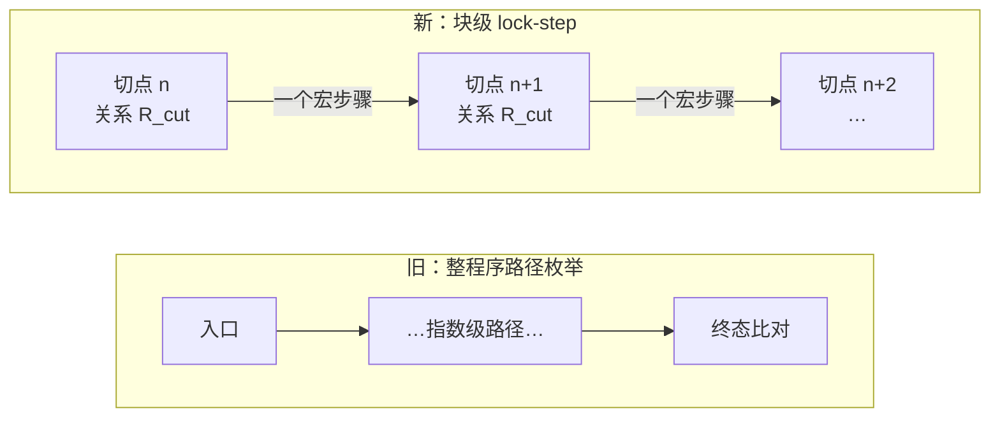
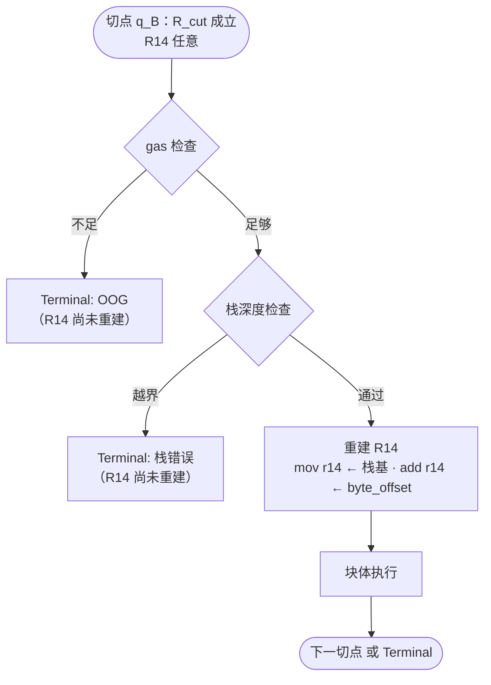
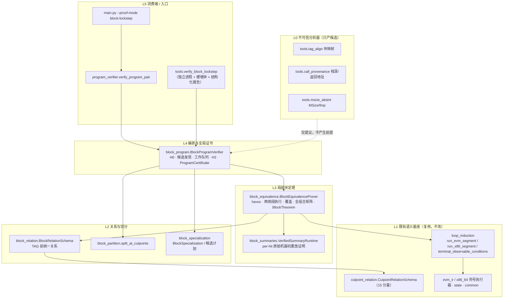
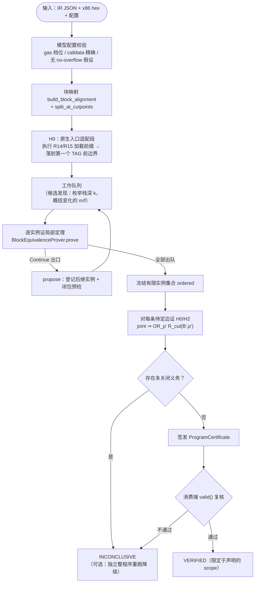

# 块级 lock-step 等价验证 — 概要设计

> **版本**：2026-09-17 · v1
> **状态**：设计基线。本文描述**目标设计**的思路与架构；实现进度与差距见《详细设计》附录 A。
> **读者**：需要理解"这套方案在干什么、为什么这么切、各模块怎么分工"的人。不需要先读代码。

## 0. 文档地图

这条路线共三份文档，职责严格分开，避免互相抄：

| 文档 | 回答的问题 | 什么时候读 |
|---|---|---|
| **本文（概要设计）** | 思路是什么？为什么这么设计？系统由哪些部分组成？ | 第一份读 |
| [详细设计](块级lockstep等价验证-详细设计.md) | 有哪些接口？每个接口的前置/后置条件是什么？流程怎么走？证明义务清单是什么？ | 要实现或要逐条核对时读 |
| [块级lockstep等价验证方案](块级lockstep等价验证方案.md) | **什么是不允许的**？每条禁令防的是哪种假绿？ | 要判断某个做法是否健全时查 |

第三份是**义务契约与禁令规范**，它逐句列出"不能 X / 不得 Y"，是被前两份引用的约束源，本文不重复搬运，只在关键处标注出处（如"§3.1"均指该文档章节）。

---

## 1. 背景与问题

### 1.1 现在的做法撞到的墙

项目已有的整程序验证（`proof-mode=paths`）是：从程序入口对 EVM IR 和 x86 机器码两侧各做一次完整符号执行，把所有终止路径两两配对比较 observable。

它的成本随分支数指数增长。实测（方案 §12.1）：

| 合约 | 整程序验证（max_depth=240） |
|---|---|
| ENSRegistry | 可跑完 |
| CErc20 | 880 秒未跑完 |
| Safe | 880 秒未跑完 |

根因不是求解器慢，而是**跨块传播的符号表达式无限增长**。已有性能记录（`perf_ext_ens_whole_contract_bottleneck`）定位到：x86 字节粒度的内存 Store 链被卷进 jcc 条件，单次 simplify 就要 3.5ms，占总耗时一半。表达式越走越大，是路径爆炸之外的第二重乘数。

### 1.2 目标

把"证明整个程序等价"这一个大问题，拆成**有限个互不依赖的小问题**，每个小问题的输入规模有上界、可以独立缓存、失败时可以独立定位。

拆完之后，用一条明确的数学论证把小结论重新组合成大结论 —— 组合过程本身也必须是被检查的，不能是"每块都绿了所以整体绿了"这种口头推理。

### 1.3 非目标

明确**不做**以下事情，写在这里是为了避免误读结论：

- 不证明程序会终止（只证明**终止行为对应**，见 §5.3）；
- 不恢复 Solidity 函数边界，不依赖源码信息；
- 不覆盖 logs、真实 host 内部执行、完整 EVM 协议、真实 REVERT 回滚语义；
- 不验证 Solidity → IR 这一段编译；输入的 IR 就是被验证的源程序；
- 不保证对任意程序都能找到合适的关系，也不保证在任意预算内完成。

---

## 2. 核心思路

### 2.1 一句话

> 在两个程序上**钉一排对齐的检查站**，只证明"相邻两个检查站之间的一步"，再用数学归纳法把这些单步结论串成整程序结论。

### 2.2 直觉

比较两条路线是否等价，有两种办法：

- **旧办法**：让两个人各自走完全程，最后比对终点。路线越长、岔路越多，要枚举的走法就越多。
- **新办法**：在每个路口设检查站，证明一条局部性质 ——

  > 任何时候，只要两人**同时**站在第 n 个检查站、且状态一致，那么他们会**同时**到达同一个第 n+1 个检查站，且状态仍然一致。

有了这条局部性质，再加上"出发时两人状态一致"（Base），归纳一下就得到全程对应。关键收益是：证明局部性质时，**不需要知道他们是怎么走到第 n 个检查站的** —— 从一个只受关系约束的、全新的符号状态出发即可。这就把表达式增长掐断了。



### 2.3 要落地必须回答的三个问题

| 问题 | 回答 | 对应机制 |
|---|---|---|
| 检查站设在哪？ | 每个 EVM 块的 **TAG 指令执行之前** | §3.1 切点选择 |
| "状态一致"具体指什么？ | 关系 `R_cut`：15 个状态分量 + 域约束 + **专门化参数** | §3.2 三参数专门化 |
| 小结论怎么变成大结论？ | Base（H0）+ 逐边闭包（H2）+ 归纳 | §5 证明骨架 |

---

## 3. 关键设计决策

### 3.1 决策一：切点定在 TAG **之前**，不是之后

这是全方案最反直觉、也最关键的一条。

x86 侧 `R14` 是 EVM 栈基址寄存器。Go codegen 的 `compileEVMTag`（`impl_amd64.go`）生成的序列是：

```
TAG 入口 → gas 检查（可能 OOG 退出） → 栈深度检查（可能报错退出） → 最后才重建 R14
```

如果把切点设在 TAG **之后**（一个很自然的选择，因为那时状态最"干净"），就等于：

1. 默认假设 R14 永远正确 —— 但进入 TAG 那一刻，R14 还是**上一个块留下的旧值**；
2. 把 TAG 自己的 OOG 和栈错误路径整段跳过 —— 而这些错误恰恰发生在 R14 修好**之前**；
3. 篡改 codegen 里重建 R14 的那两条指令，验证器不会报错。

所以切点必须在 TAG 之前，并接受一个代价：**`R_cut` 里不能要求 `R14 == stack_base + byte_offset`**。栈内容改用 canonical 的 `stack_base + byte_offset` 定位，R14 在切点上是**完全任意**的符号值。每个块定理都必须自己把 TAG 前缀（含两条错误分支）走一遍。



> 对应反向测试：篡改/删除 R14 重建指令**必须**导致证明失败（方案 §11.2 #7）。

### 3.2 决策二：`(k, m, f)` 三参数联合专门化

从"任意满足 `R_cut` 的状态"出发往往证不动，因为 x86 侧的内存地址计算全是符号表达式。解法是给关系**加索引**：

| 参数 | 含义 | 效果 |
|---|---|---|
| `k` | 绝对栈深（EVM `SP=k`，x86 `byte_offset=32k`） | 栈槽地址变常量 |
| `m` | `MSize` | 内存扩展 gas、边界比较变常量 |
| `f` | `mem[0x40:0x60]` 的 256-bit 大端值 | Solidity 的 free memory pointer；绝大多数内存写地址由它派生 |
| `κ` | 可选：某个栈槽是字面返回地址 | 让动态 JUMP 的目标可判定 |

**必须联合注入**，单独注入任何一个都救不了。方案 §12.2 的实测：

| 样本块 | 只固定 m | 只固定 f | **联合固定 m+f** |
|---|---|---|---|
| ENS 1455 | 80 路径 / 35.4s | timeout | **11 路径 / 3.0s** |
| CErc20 5343 | timeout | timeout | **49 路径 / 42.5s** |
| Safe 6275 | 8 路径 / 4.8s | timeout | 8 路径 / 4.9s |

`m` 和 `f` 各自可以是**精确整数**或 `None`（符号形式，一个节点代表一整族值）。同一个块可以同时登记多个实例，用有限析取覆盖。

> **关键认识**：这些参数**本身就是归纳不变式**，不是性能旁路。每个参数谓词必须同时出现在四处 —— havoc 前提、Base（H0）、逐边闭包（H2）、证书身份 key。漏掉任何一处就是"定理证在 A 上、应用到 B 上"型假绿（方案 §3.3）。

### 3.3 决策三：局部定理与证书图**分层**

一个块的局部定理（`BlockTheorem`）**故意不证明**"后继状态满足后继块的关系"。它只证到"实际后继程序点两侧配对"为止。后继关系由编排层的边证书（`EdgeCertificate`）单独证明。

理由：

- 局部定理可以在**后继候选集合还没冻结**的时候就先证出来，天然支持工作队列式发现；
- 循环（含自环）不会陷入"证 A 要先证 B、证 B 要先证 A"的死锁 —— 边证书引用的是后继的**关系定义**，不是后继的**正确性**；
- 义务边界清晰：局部失败和闭包失败是两类不同的诊断。

代价是：**单个 `BlockTheorem` 绿了什么都不代表**。必须由消费端检查"每个 Continue×Continue 结果对都有一张对应的、已证明的边证书"才能闭合。这条在实现上由 `ProgramCertificate.valid()` 强制。

### 3.4 决策四：summary 只是"提议"，每次命中都要重新证

CALLDATALOAD、copy-loop 的 summary 是性能杀器，也是最大的信任漏洞。本方案的做法是把它降格为**提议**：

> 每次 summary 命中，都从当前实际状态出发，**关闭全部 summary、重放那段原始机器码切片**，证明重放结果被 summary 的抽象结果包含。

这不是"模板证一次就一直信"，而是 per-hit。慢，但不可伪造。特别地，CALLDATALOAD 的符号 offset **不允许**通过追加 no-overflow 假设放行 —— 这条纪律后来直接换来了一个真实反例（见 §7.2）。

### 3.5 决策汇总

| # | 决策 | 主要备选 | 为什么选它 | 代价 |
|---|---|---|---|---|
| 1 | 切点在 TAG 前 | 切点在 TAG 后 | 不假设 R14，覆盖 TAG 自身错误路径 | 关系变弱，每块要重走前缀 |
| 2 | `(k,m,f,κ)` 联合专门化 | 只用栈深 `k` | 实测单参数 timeout、联合秒级 | 实例数膨胀，需候选分析 |
| 3 | 局部定理 / 证书图分层 | 局部定理直接含后继关系 | 支持循环、支持增量发现 | 单块结果不可单独消费 |
| 4 | summary per-hit 重放证明 | 模板证一次 + 每次匹配 | 不可伪造 | 慢；长符号 copy 无常数成本证明 |
| 5 | `m/f` 支持 `None` 符号节点 | TOP 一律降级重跑 | TOP 块占 CErc20 的 56%，全降级等于放弃 | 符号节点成本高 |
| 6 | 降级 = 独立整程序重跑 | 局部结果 + 部分重跑混用 | 混用需要额外组合假设，易出假绿 | 重跑不复用任何已有工作 |

---

## 4. 系统架构

### 4.1 分层



**L0 的虚线是刻意的**：分析器的输出一律是**未受信的候选**。它可以少给（导致 inconclusive），可以给错（导致 H0/H2 证不过），但它的任何结论都不会变成待证程序的假设。这是本架构的安全底线。

### 4.2 模块职责

| 模块 | 职责 | 明确**不**负责 |
|---|---|---|
| `block_relation.BlockRelationSchema` | 定义 TAG 前的统一关系 `R_cut`；构造 havoc 状态；产出关系义务 | 不做任何求解 |
| `block_partition.split_at_cutpoints` | 在指令边界把 x86 basic block 切开，使每个切点成为块首 | 不移动、不删除任何指令 |
| `block_specialization` | `BlockSpecialization` 值对象 + 参数合法性校验；候选计划归一化 | **不证明任何可达性或闭包** |
| `block_equivalence.BlockEquivalenceProver` | 单个 `(B,p)` 的完整局部定理：havoc → 两侧段执行 → 覆盖 → 全组合矩阵 → 终态 observable | 不证后继关系（交给 L4） |
| `block_summaries.VerifiedSummaryRuntime` | summary 每次命中的原始机器码重放证明 | 不在失败时静默放行 |
| `block_program.BlockProgramVerifier` | H0、候选发现、工作队列、冻结集合、H2、签发/校验三类证书、降级 | 不做块内语义 |
| `tools.verify_block_lockstep` | 子进程隔离 + 外层硬墙钟 + 可复现报告（哈希/配置/分层耗时/逐块诊断） | 不参与证明 |

### 4.3 端到端流程



注意 `FR`（冻结）这一步的位置：**候选集合先全部发现完、冻结，然后才统一证 H2**。预检（`closure_precheck`）在发现阶段就跑，但只作诊断，最终证据一律用冻结后的完整目标集合重算。

### 4.4 与既有代码的关系

块级路线**不改动**既有语义基座，只复用：

- 段执行 `run_evm_segment` / `run_x86_segment` 和终态比较 `terminal_observable_conditions` 来自 `verification/loop_induction.py`（原为循环归纳服务）；
- 关系 15 分量基类 `CutpointRelationSchema` 来自 `verification/cutpoint_relation.py`，`BlockRelationSchema` 通过 `site="exit"`（免除 R14 前提）+ 追加 6 类义务派生出 TAG 前版本；
- 旧的 `proof-mode=paths` 整程序路径模式完全独立保留，两者互不影响。

---

## 5. 证明骨架

### 5.1 四个字母

| | 名称 | 内容 | 谁来证 |
|---|---|---|---|
| **H0** | Base | 真实初始输入执行入口适配段后，落入 `OR_p R_cut(B0,p)` | `BlockProgramVerifier`，`source=None` 的边 |
| **H2** | 逐边闭包 | 每个 Continue 结果对，`J_ij ⇒ OR_{p'∈S_B'} R_cut(B',p',e_i,x_j)` | `BlockProgramVerifier`，每条 `EdgeCertificate` |
| **H1** | 所有实际到达都被覆盖 | **不单独证** —— 由 H0 + H2 沿执行步数归纳自动得到 | 数学推论 |
| **H3** | 候选收敛 | 工作队列为空、依赖图闭合、无未关闭义务 | `ProgramCertificate.valid()` |

**H2 最容易被做错**，方案 §5.3 给的反例值得记住：

> 块 A 执行后两侧 `MSize` 都从 96 变成 128，但后继块 B 只登记了 `m=96` 这一个实例。此时"两侧 MSize 相等"成立 —— 但 `OR_{p'} R_cut(B',p')` 为**假**，因为没有 `m=128` 的实例可用，B 的定理不能应用。
>
> 结论：**只证 `MSize_E == MSize_X` 完全不够**，必须证出口值确实落进后继的冻结候选集合。

### 5.2 局部定理要证什么

从 `R_cut(B,p)` 出发，两侧各走一个**宏步骤**（TAG + 块体，直到第一次到达下一切点或语义终态），得到 EVM 路径集 `{(g_i, kind_i, state_i)}` 和 x86 路径集 `{(h_j, kind_j, state_j)}`。

**第一步 — 两侧各自覆盖完整**：`P ⇒ OR_i g_i` 且 `P ⇒ OR_j h_j`。

> 注意：guard 析取覆盖全部输入**不能单独证明执行确实到达了出口**。还必须有"这些路径是真实有限执行"的证据（执行器无 coverage 缺陷、未触 depth cap、块内循环有推进证据）。这是两件事。

**第二步 — 笛卡尔积全组合矩阵**，`J_ij = P ∧ g_i ∧ h_j`：

| EVM 结果 | x86 结果 | 义务 |
|---|---|---|
| Continue | Continue | 后继程序点两侧配对（后继**关系**由 H2 另证） |
| Continue | Terminal | `UNSAT(J_ij)` |
| Terminal | Continue | `UNSAT(J_ij)` |
| Terminal | Terminal | `J_ij ⇒ O_C(e_i) = O_C(x_j)`，含状态码 |

这个矩阵必须**全跑**。方案 §10 记了一次真实打脸：旧 PoC 的分类器只配 Continue×Continue，终态只数个数，结果把 `muti_block pc=120` 的 x86 终态状态码**全改成 255** 仍然返回 `proved, queries=0`；把 Continue/Terminal 的 guard 对调也照样通过。

**第三步 — 所有蕴含用反例形式查**：查 `P ∧ guards ∧ ¬Goal`，**只有 UNSAT 算通过**。SAT 拒绝；`unknown`/`timeout` 同样拒绝（不是"接近通过"）。

### 5.3 循环与终止：一个必须分清的区别

本方案证明的是**终止行为对应**，不是"程序会终止"：

- **EVM 源级的无限循环完全允许**。两边都无限走回边，就是对应的。不需要为合约的 SCC 找 ranking function。
- **但编译器在块内引入的循环**（copy loop、CALLDATALOAD 展开）**必须**证明有限推进。只证"如果它结束了，输出是对的"是 partial correctness，不能升级成 `VERIFIED`。

这条区分的价值已被验收：`lockstep_counter_loop` 是一个**没有源级退出条件**的无限计数器，照样拿到了完整证书。"无界循环"指的是验证不设迭代次数上限、也不按 gas 展开。

---

## 6. 结果语义与信任边界

### 6.1 五种结果，不能混用

| 结果 | 含义 | 能代表整程序等价吗 |
|---|---|---|
| `LOCAL_THEOREM_PROVED` | 某个明确前提下的局部定理成立 | **否** |
| `UNREACHABLE_PROVED` | 给定已证到达条件下该分支不可达 | **否**，且不能冒充局部定理 |
| `VERIFIED` | Base + 全部局部证书 + 闭包 + 覆盖全部通过 | **是** —— 但仅限报告 scope 里声明的模型、输入域、observable |
| `INCONCLUSIVE` | 有 timeout/unknown/缺证书/覆盖缺口/不支持形态 | 否 |
| `COUNTEREXAMPLE` | 在真实初始输入下重放确认了差异 | 否，表示模型内反例 |

一条方向性规则：**局部 havoc 下的 SAT 不等于程序有 bug**。havoc 的状态域可能比真实可达域宽。可以据此拒绝该定理，但**未经从真实入口重放确认，不得报告整程序反例**。

### 6.2 信任边界

**可信基础**：IR/机器码解析、指令语义编码、状态与路径公式编码、Z3 的有效 UNSAT、证书检查器本身、公开声明的 ABI/host 模型。

**明确不在结论内**：logs、完整 host 调用轨迹、host 内部耗尽与终止、真实 runtime 终止、真实 REVERT 回滚语义、完整 EVM 协议、Solidity → IR 的编译。

**当前 observable 投影**：终止状态码及分类、return metadata 与返回内容、完整 storage 与 transient storage 终态、请求时的 gas 终值。

---

## 7. 成本、风险与现状

### 7.1 成本模型

```
总成本 ≈ 分析成本
       + Σ(每块 × 每个参数实例的段执行与证明成本)
       + Base / 闭包 / 覆盖 / 证书组合成本
       + 已实际发生的降级成本
```

这**不是**关于块数的线性复杂度保证。参数组合数、块内路径数、内部循环和单次 solver 查询仍可能昂贵。

### 7.2 已验收的能力

五个真实编译的小型 EVM runtime 合约（由未修改的 `go-hpc-evm b3ddbdb5` 实际编译，哈希记录在 `tests/data/lockstep_loops_manifest.json`），在 `FIXED_BUDGET` 与 `FULL` 两种 gas 模式下**都取得了完整程序证书**：

| fixture | 循环形态 | 覆盖到的能力 |
|---|---|---|
| `lockstep_counter_loop` | 无源级退出条件的 256-bit 计数循环 | 真实入口、TAG/OOG、自回边 |
| `lockstep_fmp_loop` | 每轮读写 `mem[0x40]` 后回跳 | **符号 m/f 实例**、完整内存关系 |
| `lockstep_storage_loop` | 符号 calldata 控制、持续 SLOAD/SSTORE | storage、host gas 序号、正常返回 |
| `lockstep_return_loop` | 经辅助块 + 动态 JUMP 返回循环头 | **返回地址谓词 κ**、真实动态 JUMP |
| `lockstep_calldata_loop` | 以 calldata 首字为计数递减至零 | 条件回边、正常返回、OOG |

### 7.3 未闭合的缺口

| 缺口 | 现状 |
|---|---|
| 大型合约 | CErc20 两轮长预算（1800s / 600s）**均硬超时，无整程序证书**；723 块中仅返回 172 / 95 个局部实例 |
| TOP 参数比例 | CErc20：404 块 MSize TOP、435 块 fmp TOP；Safe：350 / 368。只能走成本更高的符号节点 |
| CALLDATALOAD 回绕 | 已抓到真实 SAT 反例：`calldata_size=2^64−2, offset=2^64−32` 时 `offset+32` 在机器码中回绕选择完整 word，EVM 语义要求末两字节零填充。**尚未确认是否从 Init 可达**，也未自动追加长度上界 |
| 长符号 copy | per-hit 重放是正确性门，不是任意长度的常数成本归纳证明 |
| 区域混用（方案 §8.3） | 未启用 |
| 并行 | 块模式当前串行 |

> §7.2 那个反例正是 §3.4 纪律的回报：如果当初图省事加了 no-overflow 假设，它会被永久掩盖。

---

## 8. 演进路线

| 阶段 | 产出 | 完成判据 |
|---|---|---|
| 0 | 关闭假绿 API | 终态破坏、跨类别 guard 交换、漏字段均不能返回可消费成功 |
| 1 | 统一 TAG 前边界关系 | 任意旧 R14 可处理；破坏前缀被拒；不重复扣 TAG gas |
| 2 | 局部完整定理 | 直线/分支/自环/OOG/错误/返回值/storage 反向用例全过 |
| 3 | Base 与闭包 | 专门化错用、漏后继、假不可达、缺 Base 必须被拒 |
| 4 | 全局证书消费 | 小程序从真实入口拿到证书；删任一必需证据即不再 VERIFIED |
| 5 | 已证明的 summary | 符号边界、frame、内部终止、配置失配测试全过后才用于性能实验 |
| 6 | 真实合约评估 | 同范围基线、分层耗时、真实缺口、复现材料齐全（不预设通过率） |
| 7 | 可选区域混用 | 接管/展开恰好一次；区域所有入口与内部循环均有证据 |

阶段 0–4 已有实现落地（详见《详细设计》附录 A），阶段 5 部分落地，阶段 6 有初步报告但未闭合，阶段 7 未启动。

---

## 9. 参考

- 义务契约与禁令：[块级lockstep等价验证方案](块级lockstep等价验证方案.md)
- 接口与流程：[块级lockstep等价验证-详细设计](块级lockstep等价验证-详细设计.md)
- 历史背景：[循环处理增强方案](循环处理增强方案.md)、[cutpoint泛化方案](cutpoint泛化方案.md)
- 目标 codegen：`$GOPATH/src/github.com/bcds/go-hpc-evm/evm/aot/impl_amd64.go`，重点核对 `compileEVMTag`、`compileEVMJUMP`、`compileEVMCALLDATALOAD` 及 bridge/退出代码
- 运行报告：`docs/reports/block-lockstep-*/`
