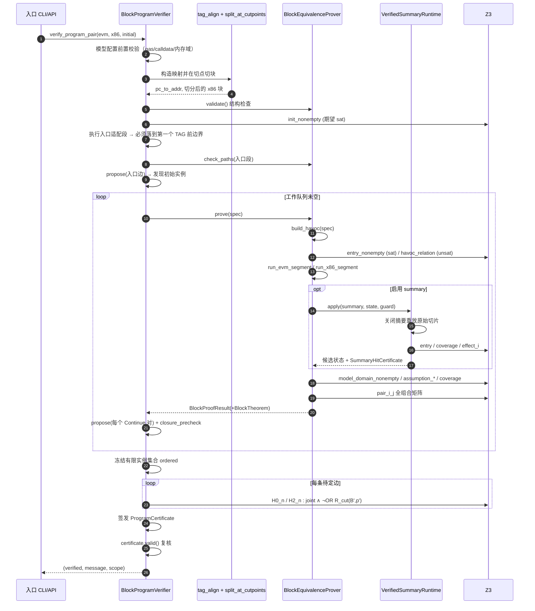
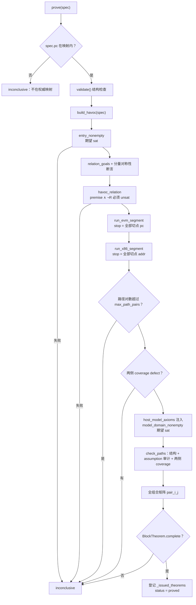
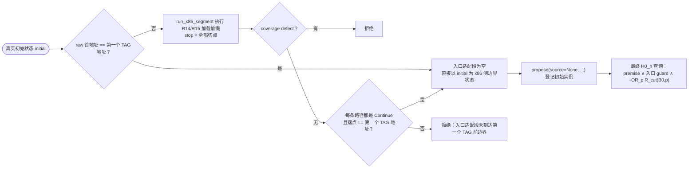
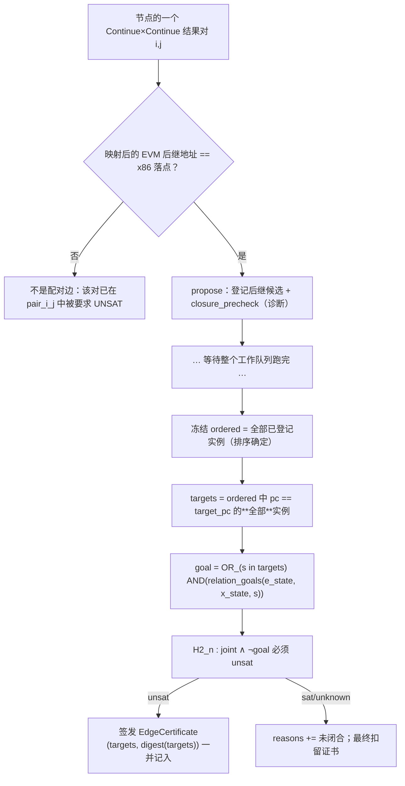

# 块级 lock-step 等价验证 — 详细设计

> **版本**：2026-09-17 · v1
> **状态**：本文是**目标设计规范**。接口用契约语言（前置条件 / 后置条件 / 拒绝条件）描述"应该是什么"，并标注实现位置便于核对。目标设计与当前实现的差距集中在 [附录 A](#附录-a当前实现与目标设计的差距)。
> **前置阅读**：[概要设计](块级lockstep等价验证-概要设计.md)（思路与架构）。禁令出处：[方案文档](块级lockstep等价验证方案.md)（下文 `§n` 均指该文件章节）。

## 1. 阅读约定

- **MUST / MUST NOT**：违反即为健全性缺陷，必须有对应的反向测试。
- **SHOULD**：工程建议，违反只影响成本或诊断质量。
- 所有"证明"一律指：构造反例公式交给 Z3，**且仅接受 `unsat`**。`sat` 和 `unknown` 都是拒绝。
- 本文所有代码标识符按实现现状书写，便于逐条对照源码。

---

## 2. 术语与符号

| 符号 | 含义 |
|---|---|
| `P_E` / `P_X` | 被验证的 EVM IR 程序 / x86 字节程序 |
| `C` | 冻结的语义配置（gas 档位、observable 集合、host 模型、summary 配置、ABI profile…） |
| `A_C` | 公开冻结的环境前提 |
| `I_C(e0,x0)` | 两侧真实初始状态关系 |
| `O_C` | 终态 observable 投影 |
| `B` | 一个 EVM 块（由其 `pc` 标识） |
| `p = (k, m, f, κ)` | 专门化参数：栈深 / MSize / `mem[0x40]` / 栈常量谓词 |
| `R_cut(B,p,e,x)` | 块 `B` 在参数 `p` 下的**切点边界关系** |
| `D_C` | 域约束（对齐、上界、表示范围） |
| `q_B` | 块 `B` 的切点程序位置：**TAG 第一条实际指令之前** |
| `J_ij` | `P ∧ g_i ∧ h_j`，一对跨侧路径的联合条件 |
| Continue / Terminal | 宏步骤结果：到达下一切点 / 进入语义终态 |
| 宏步骤 | 从 `q_B` 出发，执行 TAG + 块体，直到**第一次**到达下一切点或终态 |

---

## 3. 数据模型

### 3.1 `BlockSpecialization` — 专门化参数（值对象）

`verification/block_specialization.py`

| 字段 | 类型 | 语义 | 校验（`__post_init__` MUST 拒绝） |
|---|---|---|---|
| `pc` | `int` | EVM 块标识 | 非负整数 |
| `stack_depth` | `int` | 绝对栈深 `k` | 非负整数，`≤ 1024` |
| `memory_size` | `int \| None` | MSize `m`；`None` = 符号 | `< 2^64` 且 32 字节对齐 |
| `free_memory_pointer` | `int \| None` | `mem[0x40]` 的 `f`；`None` = 符号 | `< 2^256` |
| `stack_constants` | `tuple[(int,int), ...]` | 栈常量谓词 `κ`，`(距栈顶下标, uint256 值)` | 下标 `0 ≤ i < stack_depth`、唯一且升序；值 `< 2^256` |

**不变式**

- `frozen=True`，可哈希，可直接作为工作队列与证书集合的键；
- `None` 表示"该量保持自由符号 + 两侧相等 + `D_C`"，**MUST NOT** 被解释为"任意值都免检"或"采样到的某个模型值"；
- 参数 MUST 按宽度/非负/对齐/上界显式校验，**MUST NOT** 靠位向量截断悄悄接受非法整数（§3.3）。

### 3.2 `SegmentPath` — 段执行的一条出口路径

`verification/loop_induction.py`（既有类型，复用）

| 字段 | 类型 | 语义 |
|---|---|---|
| `kind` | `"exit" \| "latch" \| "terminal"` | Continue（`exit`/`latch`）或 Terminal |
| `location` | `int \| None` | 到达的 pc（EVM 侧）/ addr（x86 侧）；terminal 为 `None` |
| `condition` | `BoolRef` | 从切点执行到该结果的路径 guard |
| `state` | `SMTState` | 该路径的出口状态 |

### 3.3 `Obligation` — 一条具名证明义务

`verification/block_equivalence.py`

| 字段 | 语义 |
|---|---|
| `name` | 义务名（进入 `required` 清单比对） |
| `formula` | 提交给 solver 的**反例公式** sexpr |
| `answer` | solver 实际返回（`unsat`/`sat`/`unknown`） |
| `expected` | 期望答案，默认 `"unsat"`（非空性检查用 `"sat"`） |
| `elapsed_seconds` | 单条耗时，用于分层报告 |
| `proved` | `answer == expected` |

### 3.4 `BlockTheorem` — 局部块定理

| 字段 | 语义 |
|---|---|
| `identity` | 证明器身份指纹（见 §4.4.2） |
| `spec` | 该定理的入口参数 `p` |
| `obligations` | 实际执行的义务记录，**按执行顺序** |
| `required` | **独立推导**的期望义务清单（`obligation_manifest`） |
| `outcome_digest` | 两侧路径集合的摘要 |
| `evm_count` / `x86_count` | 两侧路径条数 |
| `finite_execution` | 有限推进证据 |
| `summary_hits` / `summary_hit_count` | per-hit summary 证书及其计数 |

**`complete` 的判据**（MUST 全部成立）：

1. `finite_execution` 为真，两侧路径数均 `> 0`；
2. 义务名无重复，且 `names == required` —— **顺序也必须一致**；
3. 必含 `{entry_nonempty, model_domain_nonempty, havoc_relation, evm_coverage, x86_coverage}`；
4. 对所有 `i<evm_count, j<x86_count`，`pair_{i}_{j}` 均在场；
5. 所有义务 `proved`；
6. `len(summary_hits) == summary_hit_count` 且每张 summary 证书 `complete`。

> **设计要点**：`required` MUST 从"路径集合 + 入口 assumptions + 必需义务"**独立推导**，**MUST NOT** 从已记录的查询列表抄写 —— 否则"漏跑一条义务"和"少记一条义务"无法区分。

### 3.5 三类证书

`verification/block_program.py`

| 证书 | 字段 | 语义 |
|---|---|---|
| `EdgeCertificate` | `source`（`BlockSpecialization \| None`，`None`=入口边）、`pair`（`(i,j)`）、`target_pc`、`targets`（冻结后的完整目标实例元组）、`target_version`（`digest(targets)`）、`identity`、`obligation` | 一条 H0/H2 义务的证据 |
| `EntryCertificate` | `initial_digest`、`raw_address`、`evm_entry`、`obligations`、`edges`、`path_digest`、`path_count` | 真实入口适配段 + 全部入口边 |
| `ProgramCertificate` | `identity`、`scope`、`entry`、`nodes`、`edges`、`specializations`、`worklist_closed` | 闭合的整程序证书 |
| `IndependentProgramCertificate` | `identity`、`initial_digest`、`obligations`、`required`、`evm_outcomes`、`x86_outcomes`、`outcome_digest` | 降级路径独立签发，**不消费任何局部结果** |

### 3.6 `SummaryHitCertificate` — 每次 summary 命中的证据

`verification/block_summaries.py`

`complete` 要求：`finite` 且 `raw_path_count > 0` 且 `identity` 非空，义务集合含 `{entry, coverage}` 及所有 `effect_{i}`（`i < raw_path_count`），且全部 `proved`。

---

## 4. 接口规范

### 4.1 `BlockRelationSchema` — 边界关系

`verification/block_relation.py`，派生自 `CutpointRelationSchema`。

#### 4.1.1 关系定义

```
R_cut(B,p,e,x) = Running_E(e) ∧ Running_X(x)
               ∧ R_state(e,x) ∧ D_C(e,x) ∧ Spec_p(e,x) ∧ Inv_B(e,x)
```

`R_state` 的 15 个基类分量（来自 `CutpointRelationSchema._COMPONENTS`）：

```
stack_geometry, live_stack_prefix, memory, memory_size, free_memory_pointer,
memory_gas, gas, host_gas_seq, return_data_source, storage,
transient_storage, return_metadata, environment, callengine_environment,
callengine_mirror
```

`BlockRelationSchema` 在其上**追加** 6 类义务：

| 义务名 | 内容 |
|---|---|
| `stack_constant_predicate` | 对每个 `(i,v) ∈ κ`：EVM `peek(i) == v` **且** x86 对应栈槽 `== v`（两侧都查） |
| `running` | 两侧结构前提（均处于 running 状态）；构造时若有 defect MUST 抛错而非降级 |
| `running_return_metadata_empty` | 两侧 `return_offset == 0 ∧ return_length == 0`（显式归纳不变式，H0/H2 每次重证） |
| `domain` | `MSize ≤ cap`、`MSize % 32 == 0`（两侧各自字段）、`byte_offset ≤ max_stack_byte_offset` |
| `abi_bases` | 两侧 `R13` 相等、`callengine_stack_base` 相等、`callengine_memory_base` 相等 |
| `abi_environment_range` | `self/origin/caller` 地址的高 96 位为 0 |
| `abi_mirrors` | 对每个镜像字段：x86 内存中 `[R13+offset]` 的 limb `==` 对应 property |
| `invariant_{n}` | 每条 `persistent_invariants` |

> **`site="exit"` 的含义**：调用基类 `component_goals` 时传 `site="exit"`，即**省略 `R14 == stack_base + byte_offset` 这一项**。这正是"切点在 TAG 前"的直接体现（§3.1、概要设计 §3.1）。

#### 4.1.2 `build_havoc(stack_depth, *, prefix, stack_constants, memory_size, free_memory_pointer, host_gas_uf_enabled, assume_calldata_offset_no_overflow, ...) -> RelationContext`

**职责**：构造一个"任意满足 `R_cut` 的状态"的符号表示。

**后置条件（MUST）**

| # | 条件 | 防的是什么 |
|---|---|---|
| 1 | 参数先经 `BlockSpecialization` 校验才使用 | 非法参数悄悄进入定理域 |
| 2 | 除 `R13`/`R15` 外的**所有通用寄存器**替换为 fresh 符号 | 继承 `create_initial_state()` 的零值常量 |
| 3 | 全部 7 个标志位（CF/PF/AF/ZF/SF/OF/DF）替换为 fresh 符号 | 同上 |
| 4 | 栈内存的零填充底数组替换为 fresh 数组；仅 canonical 活跃槽被初始化 | 非活跃栈字节被当成 0 |
| 5 | callEngine 内存整体重建为 fresh 数组，再逐个写回受关系约束的镜像字段 | 残留 scratch store |
| 6 | `callengine_stack_pointer_limbs / builtin_func_index / go_func_index / return_address / builtin_arg0` 全部 fresh | side-channel 字段被当成 0 |
| 7 | `complete_jump_domain = True` | `immediate_set` 缩小参考 JUMP 目标域（§2.4） |
| 8 | `assume_calldata_offset_no_overflow` 默认强制 `False` | 未证 no-overflow 假设（§6.4） |
| 9 | `stack_constants` 同时写入 EVM 栈与 x86 栈内存**两个 canonical 视图** | 单侧写入 → 关系名义成立实则只约束一侧 |
| 10 | `return_offset = return_length = 0` 作为**显式不变式**注入，并由 H0/H2 重证 | 把初始化默认值误当成公理 |
| 11 | 每条 `persistent_invariants` 注入为 assumption | 不变式生成与检查不同步 |

**拒绝条件**：`BlockSpecialization` 校验失败；镜像/分量覆盖断言失败。

#### 4.1.3 `relation_goals(evm, x86, spec, *, memory_snapshot=None) -> tuple[RelationGoal, ...]`

**职责**：把 `R_cut` 重述到**任意给定的一对状态**上，供 havoc 自检、H0、H2 三处共用。

**MUST**：havoc、Base、每条边**使用同一个谓词构造函数**。三处用不同实现，就是"证在 A、用在 B"的标准形态。

**MUST NOT**：传入伪造的"全绑定" `context` —— 那会让分量对称性守卫恒过，等于把它关掉（见 `component_goals` 的 docstring）。

#### 4.1.4 `fingerprint`

关系版本指纹，进入证明器身份。MUST 覆盖：基类指纹、`ABI_MIRRORS` 列表、`"running_return_metadata_empty"`、`"pre-TAG"` 标记、`version`。**MUST NOT** 只包含分量名列表（§9.2）。

---

### 4.2 `split_at_cutpoints(blocks, cutpoints) -> list[X86Block]`

`verification/block_partition.py`

**职责**：把 x86 basic block 在给定地址处切开，使每个切点成为某个块的首指令。

**前置条件（MUST 拒绝）**

| 拒绝条件 | 理由 |
|---|---|
| 指令地址重复 | 区域归属不唯一（§2.3） |
| 切点不是指令边界 | 会撕裂指令语义 |
| `block.start_addr != block.instructions[0].addr` | 输入分块自相矛盾 |
| 块内指令地址不连续（存在 gap） | 有字节未被归属 |

**后置条件**：保留**全部**原始指令，顺序不变，只改变分块边界。**MUST NOT** 删除、移动或合成任何指令。

---

### 4.3 `build_specialization_plan(...) -> SpecializationPlan`

`verification/block_specialization.py`

**职责**：把不可信分析器（`tools.msize_absint` / `tools.call_provenance`）的输出**归一化**为候选实例表。

**契约**

- 本模块**MUST NOT** 证明任何可达性或闭包 —— `SpecializationPlan.ok` 只表示"候选自身无结构矛盾"；
- `coverage_summary()` MUST 显式带上 `"H0/H2 not checked"` 字样；
- 分析器的 TOP MUST 归一化为 `None`（符号节点）；**空值集合**是缺陷，不等同于 TOP（§8.1）；
- 可达集合里某块没有深度类 → 记为 violation；
- 出边指向未登记块 → 记为 violation；
- `max_instances` 是**资源上界**，耗尽即 inconclusive，**MUST NOT** 被解释为"语义发散"。

---

### 4.4 `BlockEquivalenceProver` — 局部块定理

`verification/block_equivalence.py`

#### 4.4.1 构造

```python
BlockEquivalenceProver(
    evm_blocks, x86_blocks, pc_to_addr, schema=None, *,
    timeout_ms=30_000,          # 单条 solver 查询预算
    max_depth=400,              # 段执行深度上限
    aot_profile=None,           # 默认 GO_HPC_EVM_PROFILE
    compare_gas=True,           # 终态是否比较 gas
    host_gas_uf_enabled=True,   # MUST 与 GasCheck 档位一致
    summary_config=None,        # None = 关闭 summary
    deadline=None,              # 全局软墙钟绝对时刻
    max_path_pairs=100_000,     # 路径对资源上界
    node_timeout_seconds=None,  # 单节点软预算
)
```

#### 4.4.2 `identity`（证明器身份）

MUST 覆盖以下全部内容；任一变化都 MUST 使旧定理失效：

```
EVM 块 JSON  ·  x86 逐指令 (addr,size,bytes,mnemonic,op_str)  ·  pc→addr 映射
schema.fingerprint  ·  aot_profile  ·  compare_gas  ·  host_gas_uf_enabled
HOST_GAS_UPPER_BOUNDS 表  ·  全部语义源码的 sha256  ·  summary 配置
语义函数对象 id（run_evm_segment / run_x86_segment / terminal_observable_conditions /
                relation_goals / build_havoc）
```

> **两点设计说明**：
> ① `_semantic_sources_digest()` 把 `common/state/evm_ir/x86_64/verification` 全部 `.py` 一起哈希 —— 语义实现改了，证书就失效。
> ② 函数对象 `id` 用于捕获运行内的 monkeypatch（测试注入）；因为依赖对象 ID，本身份**只允许运行内使用，MUST NOT 持久化落盘**（§9.2）。

#### 4.4.3 `validate()`

结构前置检查，MUST 拒绝：

| 拒绝条件 | 理由 |
|---|---|
| `schema` 不是 `BlockRelationSchema` | 误用 TAG 后的循环 schema |
| `aot_profile != GO_HPC_EVM_PROFILE` | 未支持的 ABI |
| `pc_to_addr` 非单射 | 两块共用一个实现区域 |
| EVM 块 pc 重复 | 块标识不唯一 |
| `set(pc_to_addr) != {b.pc}` | 分析器把块从映射中抹掉 |
| x86 块起始地址重复 | 区域归属冲突 |
| 映射目标不在 x86 块首集合中 | TAG 不是切分边界（§2.2） |
| 任一预算 `≤ 0` | 无意义配置 |

#### 4.4.4 `prove(spec) -> BlockProofResult`

核心流程见 §5.2。**签发条件**：只有 `BlockTheorem.complete` 为真才把定理登记进 `_issued_theorems` 并置 `status="proved"`。

**异常处理契约（MUST）**：任何异常、任何 `unknown`、任何缺失语义字段都 MUST 使结果保持 `inconclusive`，**MUST NOT** 产出定理。实现方式是整段 `try/except` 包住，异常只追加 `reasons`。

#### 4.4.5 `BlockProofResult.proved`

**MUST NOT** 只看 `status` 字段。判据（`_proved_for_identity`）要求全部成立：

1. `status == "proved"` 且 `reasons`、`control_flow_defects` 均为空；
2. `theorem is not None` 且 `theorem.complete`；
3. `theorem.spec == self.spec`（定理与请求的参数一致）；
4. `theorem.identity == 当前证明器 identity`（程序/模型/配置未变）；
5. 该定理对象**确实由本证明器签发过**（`any(t is issued for issued in _issued_theorems)`，身份比较用 `is`）；
6. `theorem.outcome_digest == paths_digest(evm_outcomes, x86_outcomes)`（执行产物未被替换）。

> 条件 5、6 防的是"外部构造一个字段齐全的 `BlockTheorem` 塞进结果"和"证完后把状态换掉"。

#### 4.4.6 `check_paths(evm, x86, premise, initial, records)`

对每一侧执行：

1. 路径集非空，否则拒绝；
2. 每条路径 `kind ∈ {terminal, exit, latch}` 且 `condition` 是 Boolean，否则"未分类结果"；
3. 每条路径的 `pending_errors` / `pending_constraints` 队列 MUST 为空（有未消费的错误就是语义漏建模）；
4. `unrouted_memory_domain` MUST 为空（内存域未解析）；
5. **新增 assumption 逐条审计**：执行器在途中添加的、不在入口 assumptions 里的每一条，MUST 用 `And(premise, Not(assumption))` 单独证明；
6. **覆盖义务**：`And(premise, Not(Or(*guards)))` MUST unsat。

> **第 5 条的关键细节**：审计公式 **MUST NOT** 使用该路径的最终 guard —— 最终 guard 里已经包含了正被审计的 assumption，会自证（重言式）。必须只用**原始 premise**。这是一个真实踩过的坑（源码注释明确标注）。

#### 4.4.7 `host_model_axioms(expressions) -> tuple[BoolRef, ...]`

遍历两侧全部 guard 与 premise 的表达式树，找出所有 `host_gas_<OPCODE>` 未解释函数项，为每个项实例化 `ULE(term, HOST_GAS_UPPER_BOUNDS[OPCODE])`。

**契约**

- 这是**模型公理**，不是输入假设也不是学到的路径条件；
- 签名不符（返回宽度 ≠ 64 或参数宽度 ≠ 256）MUST 抛错；
- 对两侧全部项统一实例化，使两侧覆盖在**同一 oracle 模型**下检查；
- **MUST NOT** 在此处混入任何其他待定约束。

---

### 4.5 `VerifiedSummaryRuntime` — per-hit summary 证明门

`verification/block_summaries.py`。以 `__getattr__` 代理既有 summary runtime，只拦截 `apply`。

#### `apply(summary, state, path_condition=None) -> SMTState`

**步骤与义务**

| # | 步骤 | 义务 / 拒绝条件 |
|---|---|---|
| 1 | 固化 `before` 状态（读一遍全部寄存器/标志/指针 tag 以固定表示） | — |
| 2 | 非空性 | `entry`：`premise` 必须 **sat** |
| 3 | **所有权检查** | 接管指令集合 MUST 含入口、MUST NOT 含 continuation、MUST NOT 与任何切点相交 |
| 4 | **边界检查** | 接管区内 MUST NOT 出现 `ret` / `call`（不得隐藏 host/返回边界） |
| 5 | 原始重放 | 在 `{entry, continuation}` 处切块，**关闭所有 summary**，执行原始机器码切片 |
| 6 | 重放完整性 | 有 coverage defect 或零路径 → 拒绝 |
| 7 | 覆盖 | `coverage`：`premise ∧ ¬OR(raw guards)` 必须 unsat |
| 8 | 应用 summary 提议 | CALLDATALOAD MUST 关掉 `require_concrete_offset`（改由本门在真实域上检查）|
| 9 | 无新假设 | summary 引入任何新 assumption / `pending_*` / `summary_assumed_premises` → 拒绝 |
| 10 | clobber 见证 | 对每个 fresh clobber 符号，用各 raw 路径的**实际机器值**作存在性见证；入口已存在的符号 MUST NOT 被重新绑定；见证符号 MUST 互不重复 |
| 11 | 指针 provenance | 若各 raw 路径给出的 pointer tag 不唯一 → 拒绝（路径相关 provenance 不可摘要） |
| 12 | raw 路径 assumption 审计 | 同 §4.4.6 第 5 条 |
| 13 | **逐路径效果包含** | `effect_{i}`：raw 路径若 terminal 或落点 ≠ continuation → goal 为 `False`（必失败）；否则 goal = 逐字段状态相等（经见证替换） |
| 14 | 签发 | `SummaryHitCertificate.complete` 为假 → 拒绝 |

**失败语义**

- `ProofBudgetExceeded` 原样上抛 —— **MUST NOT** 把预算到期转成 summary fallback（否则"超时"会静默变成"用了未证摘要"）；
- 其他失败包装为 `SummaryPreconditionError`，由上层决定 strict 拒绝还是 fallback 执行原始指令；**fallback 执行的原始指令仍须通过完整局部定理**。

**`_equal_state` 的 frame 契约**：逐叶子比较两个状态的**全部字段**；字段集合不同 → "summary 改变了状态表示"；非表达式字段值不等 → "frame mismatch"。`assumptions` 与 `summary_assumed_premises` 单独审计，不进入此比较。

---

### 4.6 `BlockProgramVerifier` — 编排与全局证书

`verification/block_program.py`

#### 4.6.1 构造

```python
BlockProgramVerifier(*,
    gas_check=GasCheck.FIXED_BUDGET,
    timeout_ms=30_000,          # 单查询
    max_depth=400,              # 段执行深度
    max_instances=2048,         # 实例总数上界
    max_values_per_edge=32,     # 单条边枚举栈深值的上界
    wall_timeout_seconds=300,   # 编排软墙钟
    schema=None,
    fallback="none",            # "none" | "full-program"
    summary_config=None,
    progress_callback=None,     # 每完成一个节点回调
    node_timeout_seconds=60,    # 单节点软预算
)
```

`fallback` 取值超出枚举 MUST 构造期就抛错。

#### 4.6.2 `verify_program_pair(evm_program, x86_program, initial_state, *, candidates=None) -> BlockProgramResult`

**模型配置前置校验（MUST 全部通过，否则不进入证明）**

| 检查 | 拒绝理由 |
|---|---|
| 预算均为正 | 无意义配置 |
| 程序非空 | — |
| 有 `static_gas` 的块必须含 TAG | 静态 gas 的 OOG 守卫挂在 TAG 上；无 TAG 时 gas 会回绕成 `~2^64` 静默继续 |
| 非 OFF 档时无不支持的动态 gas op | 未建模扣费 |
| `initial.abstract_calldataload_words == False` 且 `assume_calldata_offset_no_overflow == False` | 块模式要求精确 calldata、无 no-overflow 假设 |
| `initial.unrouted_memory_domain is None` | 内存域兜底不是生产模型 |
| `evm_gas.Gas` 与 `callengine_gas_remaining` 一致 | 两侧初始 gas 不同步 |
| `(gas_check == FULL) == is_bv_value(gas)` **为假** | 初始 gas 具体性与请求档位矛盾 |
| `initial.host_gas_uf_enabled == (gas_check != OFF)` | host gas 设置与档位不符 |

**输入状态处理**：`initial = initial_state.copy()`，**MUST NOT** 就地修改调用方对象；此后每个执行器再各拿独立 copy。

**scope 字符串**：MUST 完整声明模型、calldata 域、跳转目标域、summary 模式、gas 档位与初始预算、被比较的 observable 列表、host 模型边界。这是 `VERIFIED` 结论的适用范围声明，会随证书一起校验（`result.scope == result._issued_scope`）。

#### 4.6.3 `_discover(pc, state, joint, budget) -> tuple[BlockSpecialization, ...]`

**职责**：在 `candidates=None`（自动模式）时，从**实际出口状态与 joint 条件**发现后继实例。

**算法**

```
1. 缓存键 = (pc, SP/MSize/mem[0x40] 的 sexpr, Stack 的 sexpr, joint 的 sexpr)
2. solver.add(joint)
3. 循环：
     check() == unsat  → 结束，返回已收集实例
     check() != sat    → 抛错（枚举 unknown，不得当作"没有更多值"）
     取模型中的 SP 值 depth
     m/f：simplify 后是字面量则取值，否则 None
     κ：栈中已是字面量、且属于 IR 导出返回 pad 集合的槽
     若同一 (pc, depth, κ) 先前记录过不同的 (m,f) → 概括为 (None, None) 并固定
     登记实例；solver.add(SP != depth) 继续
4. 超过 max_values_per_edge → 抛错（资源上界，非语义结论）
```

**契约**

- **只枚举栈深**，内存参数用"具体 → 变化后概括为符号"的单调策略，每个 `(pc,k,κ)` 至多产生一个具体 + 一个符号提案；
- `None` 表示"两侧相等 + schema 域"，**MUST NOT** 被理解为采样到的模型值；
- κ 只保留**实际出口中已是字面常量**、且属于编译产物返回 pad 集合的栈值；两侧实际栈槽都要等于该值；无法恢复字面值时**不添加**该谓词，**MUST NOT** 缩小任何参考 JUMP 目标域；
- 所有提案仍 MUST 经过 H0/H2 才被接受。

#### 4.6.4 `ProgramCertificate.valid(prover, initial)` — 全局成功门禁

这是 `VERIFIED` 的**唯一**判据。MUST 逐条检查：

| # | 检查 | 防的是什么 |
|---|---|---|
| 1 | 证书对象是本 prover 亲自签发的那一个（`is` 比较） | 外部构造证书 |
| 2 | `worklist_closed` 为真、`identity` 等于当前 prover identity、`scope` 非空 | 程序/模型变更后复用 |
| 3 | `entry.initial_digest == state_digest(initial)` | 换初始状态 |
| 4 | 入口义务含 `{init_nonempty, evm_coverage, x86_coverage}` 且全部 proved | 入口段偷工 |
| 5 | `len(entry.edges) == entry.path_count ≥ 1` | 入口边缺失 |
| 6 | `specializations` 非空且**无重复** | 集合退化 |
| 7 | `nodes` 与 `specializations` **一一对应** | 有登记实例没有定理 |
| 8 | 每个 node 的 `_issuer is prover` 且 `_proved_for_identity` 通过 | 见 §4.4.5 |
| 9 | **重新从节点执行产物枚举**所有 Continue×Continue 对，得到 `expected`；`{(source,pair)}` 必须与之**完全相等** | 漏掉一条实际出边 / 多出一条伪造边 |
| 10 | 入口边 pair 集合恰为 `{(0,j)}` | 入口边编号错位 |
| 11 | 每条边：`target_pc` 与节点实际出口 `location` 一致 | 边指向错块 |
| 12 | 每条边：`identity` 一致、`obligation.proved`、`targets == 冻结集合中该 pc 的全部实例`、`target_version == digest(targets)`、`targets ⊆ specs` | 用旧/窄的目标集合冒充完整析取 |

> 第 9 条是整个门禁的核心：它**不信任**证书自报的边列表，而是从节点的执行产物**重新推导**应有的边集合再比对。

#### 4.6.5 降级：`_independent_rerun`

启用条件：`fallback="full-program"` 且模型配置校验已通过。

**契约（MUST）**

- 全新 executor、全新公式、**原始初始状态**、**空 stop 集合**、`pc_to_addr={}`（连块映射都不用，映射失败也能降级）；
- 两侧所有路径 MUST 全为 terminal，否则"独立执行留下非终止结果"；
- 走完整的 `check_paths` + 全对终态比较；
- 签发 `IndependentProgramCertificate` 并经 `valid()` 复核；
- **MUST NOT** 复用任何局部定理、局部计数、中间状态（已扣 gas / 已写 storage）；
- 原块图失败原因保留在 `block_failure_reasons` 作诊断。

#### 4.6.6 `BlockProgramResult.verified`

```
status == "verified"  ∧  reasons 为空  ∧  certificate 非 None
∧  scope 非空且 == _issued_scope
∧  certificate.valid(_prover, _initial)
```

任一环节抛异常一律返回 `False`（`except: return False`）。

---

### 4.7 外部入口

#### 4.7.1 `ProgramEquivalenceChecker.verify_program_pair(..., proof_mode="block-lockstep", block_options=None)`

`verification/program_verifier.py`

**拒绝条件**

| 条件 | 消息 |
|---|---|
| `fold_loops` 或 `stack_check` 非空 | 块模式不消费旧的 summary/folding/debug-stack 证书 |
| `block_options` 含 `gas_check` 或 `timeout_ms` | 不允许覆盖已请求的 gas/solver 配置 |
| 非块模式却传了 `block_options` | 选项与模式不符 |

**状态准备**：强制 `host_gas_uf_enabled = (gas_check != OFF)`、`assume_calldata_offset_no_overflow = False`、`abstract_calldataload_words = False`。

**返回**：`(result.verified, result.message)`。

#### 4.7.2 CLI

```bash
poetry run python main.py <ir.json> "$(cat <x86.hex>)" \
  --proof-mode block-lockstep --gas-check full
```

- 块模式下 `num_inputs` 默认 **0**（真实初始栈深为 0）；要验证非空初始栈须显式 `--num-inputs`；
- `--block-fallback` 仅在块模式下允许。

#### 4.7.3 `tools.verify_block_lockstep` — 可复现报告驱动

```bash
poetry run python -m tools.verify_block_lockstep <stem> \
  --gas-check full --summaries --timeout-ms 3000 \
  --wall-seconds 300 --hard-wall-seconds 360 --output result.json
```

**三层预算（缺一不可）**

| 层 | 参数 | 能打断什么 | 不能打断什么 |
|---|---|---|---|
| 单查询 | `--timeout-ms` | 一次 Z3 求解 | Python 侧符号展开 |
| 单节点软预算 | `--node-seconds`（默认 60） | 本节点后续查询与 summary 检查 | 正在执行的 C 扩展 |
| 编排软预算 | `--wall-seconds` | 工作队列继续取任务 | 同上 |
| **外层硬墙钟** | `--hard-wall-seconds` | **整个工作子进程**（父进程监督 + terminate/kill） | — |

> 前三层都**不能**强制打断正在执行的 Python/C 扩展，所以外层硬预算是必需的。**MUST NOT** 把"每条 solver 查询 30 秒"写成"每块最多 30 秒"（§11.3）。

**报告内容（MUST 包含）**：程序 sha256、`model_sources_sha256`（含未跟踪的新文件）、`worktree_sha256`、git revision、完整配置、主机/Python 信息、逐块诊断、闭包检查记录、分层耗时、逐节点耗时、失败义务明细、`unvisited_policy` 声明。

**进度快照**：每完成一个实例经 Pipe 回传，写入 `<output>.partial.json`；硬超时时保留最近快照。`unvisited` / `queued` **MUST NOT** 被计为已证明或不可达。

---

## 5. 流程设计

### 5.1 整体时序



### 5.2 局部块定理证明流程



**关键点：stop 集合包含当前入口自身。** 初次进入由执行器豁免一次，执行至少一个语义步骤后再遇到原入口就产生**自环边**。**MUST NOT** 为了"让它跑下去"而把当前块地址从 stop 集中删掉 —— 那会静默丢失自环边（§2.3）。

### 5.3 H0：真实入口



**契约**

- EVM 侧在入口**不执行 TAG**，以 `initial` 直接作为边界状态；x86 侧执行前缀。该段**不扣一次额外的 TAG gas**（§2.2）。
- 入口段出现 terminal 即视为 Continue/Terminal 错配，直接拒绝。
- 后续跳回 B0 的 TAG **MUST NOT** 再次执行原生入口前缀 —— 由 `split_at_cutpoints` 在指令边界切开保证。

### 5.4 H2：逐边闭包



**为什么要先冻结再证**：预检时的 `registered` 还在增长，用它算出的 goal 是**临时**的。最终证据必须用冻结后的完整目标集合，并把 `digest(targets)` 记进证书 —— 消费端会重算并比对（§4.6.4 第 12 条）。

### 5.5 失败传播

| 失败点 | 传播方式 | 对全局的影响 |
|---|---|---|
| 单个节点局部失败 | 记入 `reasons` + 逐块诊断；**继续处理队列其余节点** | 最终扣留证书 |
| 失败节点的后继 | **不生成**（没有完整执行结果就不能凭空推导后继） | 相关块保持 `unvisited` |
| H2 关系构造异常 | 记 `construction_error` 进 `closure_checks`，继续下一条边 | 最终扣留证书 |
| 节点软预算到期 | 抛 `ProofBudgetExceeded`，本节点 inconclusive | 队列继续；**MUST NOT** 污染后续节点 |
| 编排软预算到期 | `budget()` 抛错 | 走 except 分支（可选降级） |
| 外层硬墙钟到期 | 父进程 terminate/kill 子进程 | 报告 inconclusive + 最近快照 |

---

## 6. 证明义务总清单

这是**验证本方案实现是否完整**的核对表。每一行都应能在报告 JSON 的 `obligations` / `closure_checks` 中找到对应记录。

### 6.1 局部块定理（每个 `(B,p)` 实例）

| 义务名 | 公式 | 期望 | 缺失/失败的后果 |
|---|---|---|---|
| `entry_nonempty` | `premise` | **sat** | 空真定理（前提矛盾，什么都能证） |
| `havoc_relation` | `premise ∧ ¬R_cut` | unsat | havoc 表示不覆盖关系，定理域是错的 |
| `model_domain_nonempty` | `premise ∧ host 公理` | **sat** | oracle 模型与入口域矛盾 → 空真 |
| `evm_assumption_{n}` | `premise ∧ ¬assumption` | unsat | 执行器悄悄加的约束变成未证前提 |
| `x86_assumption_{n}` | 同上 | unsat | 同上 |
| `evm_coverage` | `premise ∧ ¬OR g_i` | unsat | 漏路径（本方案最常见的假绿形态） |
| `x86_coverage` | `premise ∧ ¬OR h_j` | unsat | 同上 |
| `pair_{i}_{j}` (T×T) | `J_ij ∧ ¬O_C 相等` | unsat | 终态 observable 不等 |
| `pair_{i}_{j}` (C×C 配对) | `J_ij ∧ ¬True` | unsat（恒真，仍记录） | 记录该对存在，供消费端重算边集合 |
| `pair_{i}_{j}` (其余全部) | `J_ij ∧ ¬False` = `J_ij` | unsat | 跨类别错配 / 落到不同后继 |

义务清单顺序（`obligation_manifest` 独立推导，`BlockTheorem.complete` 逐项比对）：

```
entry_nonempty, havoc_relation, model_domain_nonempty,
evm_assumption_*…, evm_coverage,
x86_assumption_*…, x86_coverage,
pair_0_0, pair_0_1, …, pair_{E-1}_{X-1}
```

### 6.2 全局

| 义务名 | 公式 | 期望 | 说明 |
|---|---|---|---|
| `init_nonempty` | 初始 premise | **sat** | 真实初始域非空 |
| `evm_coverage` / `x86_coverage`（入口段） | 同 §6.1 | unsat | 入口适配段覆盖 |
| `H0_{n}` | `premise ∧ 入口guard ∧ ¬OR_p R_cut(B0,p)` | unsat | Base |
| `H2_{n}` | `J_ij ∧ ¬OR_p' R_cut(B',p')` | unsat | 逐边闭包 |
| `closure_precheck` | 同 H2 但目标集合未冻结 | — | **仅诊断**，不是证据 |

### 6.3 Summary per-hit（每次命中）

| 义务名 | 公式 | 期望 |
|---|---|---|
| `entry` | `premise` | **sat** |
| `coverage` | `premise ∧ ¬OR(raw guards)` | unsat |
| `assumption_{i}_{n}` | `premise ∧ ¬assumption` | unsat |
| `effect_{i}` | `premise ∧ raw_guard_i ∧ ¬(状态逐字段相等[见证替换])` | unsat |

### 6.4 非查询式检查（必须在代码中显式拒绝）

| 检查 | 位置 |
|---|---|
| 分量对称性（havoc 绑定 ↔ 关系义务一一对应） | `_assert_component_symmetry` |
| 镜像覆盖 | `_assert_mirror_coverage` |
| `pending_errors` / `pending_constraints` 已清空 | `check_paths` |
| `unrouted_memory_domain` 为空 | `check_paths` |
| 结构前提无 defect | `structural_premises(site="base_arrival")` |
| summary 所有权不跨切点、不含 `ret`/`call` | `VerifiedSummaryRuntime.apply` |
| 指针 provenance 唯一 | 同上 |
| 证书身份/边集合/目标版本 | `ProgramCertificate.valid` |

---

## 7. 配置项

| 配置 | 取值 | 语义边界 |
|---|---|---|
| `gas_check=FIXED_BUDGET` | 指定具体预算 | 结论：该预算下模型行为与 gas 终值对应 |
| `gas_check=FULL` | 符号 gas | 结论：对该 gas 域**全称量化**成立 |
| `gas_check=OFF` | 关闭 host gas UF | **MUST** 醒目标注：可能改变 OOG、`GAS` 及由 gas 派生的分支；**MUST NOT** 写成"只是少比较一项 gas" |
| `summary_config=None` | 关闭 summary | 全部执行原始机器码 |
| `summary_config=X86SummaryConfig.enabled(..., "fallback")` | 命中失败时回退执行原始指令 | 回退段仍须通过完整局部定理 |
| `fallback="none"`（默认） | 不降级 | 块图失败即 INCONCLUSIVE |
| `fallback="full-program"` | 独立整程序重跑 | 见 §4.6.5；**不复用**任何局部结果 |
| `candidates=None`（默认） | 自动发现 | 见 §4.6.3 |
| `candidates={pc: (...)}` | 显式候选 | **仍不蕴含闭包**；pc 不匹配 MUST 拒绝 |

---

## 8. 验收与测试映射

方案 §11.2 列了 20 条必需基准。下表给出关键几条与本文接口的对应，便于检查"这条基准到底打在哪个门上"：

| 基准 | 打击点 | 应由哪个契约拒绝 |
|---|---|---|
| #1 单侧改 status / 返回字节 / storage / gas | 终态比较 | `pair_i_j`（T×T） |
| #2 Continue/Terminal guard 对调 | 全组合矩阵 | `pair_i_j`（跨类别，goal = `False`） |
| #4 后继 m/f 变成未登记值 | H2 | `H2_n` + `EdgeCertificate.targets` 校验 |
| #5 漏初始实例 / 用 `block.min_depth` 代替实际 SP | Base | `H0_n` |
| #6 删后继节点 / 伪造不可达 | 边集合重算 | `ProgramCertificate.valid` 第 9 条 |
| #7 篡改 TAG 的 R14 重建 | TAG 前缀语义 | `pair_i_j`（前缀真实执行） |
| #8 单侧 property 与 CALLENGINE limb 不一致 | 镜像闭包 | `abi_mirrors` 义务 + `_assert_mirror_coverage` |
| #9 自环 / 内部无进展循环 | stop 集合 + 有限推进 | coverage defect → `finite_execution` 为假 |
| #10 注入 unknown / depth cap / 异常 | 结果语义 | `Obligation.proved` 为假；异常 → `reasons` |
| #11 矛盾入口前提 / 未证 assumption | 空真与前提来源 | `entry_nonempty`(sat) + `*_assumption_*` |
| #14 CALLDATALOAD 回绕 / copy 长度 0/7/8/9 | per-hit proof | `effect_i` |
| #19 缺 Base / 缺某条边 / 缺 scope 身份 | 全局门禁 | `ProgramCertificate.valid` |
| #20 havoc 默认 scratch 常量影响输出 | havoc 完整性 | `havoc_relation` + §4.1.2 的 11 条后置条件 |

**测试位置**

```
tests/unit/test_block_lockstep_soundness.py      反向探针与健全性
tests/unit/test_block_summary_certificates.py    per-hit summary 证书
tests/unit/test_block_specialization.py          参数校验与候选归一化
tests/integration/test_block_equivalence.py      局部块定理
tests/integration/test_block_program.py          H0/H2/证书闭合
tests/integration/test_block_closure_guards.py   闭包守卫
tests/integration/test_block_symbolic_loops.py   五个真实编译的循环 fixture
```

复现：

```bash
poetry run python -m tools.generate_block_loop_fixtures --compiler-root $GOPATH/src/github.com/bcds/go-hpc-evm
poetry run pytest tests/integration/test_block_symbolic_loops.py -q
poetry run python -m tools.verify_block_lockstep tests/data/lockstep_fmp_loop \
  --gas-check full --timeout-ms 10000 --wall-seconds 180 --hard-wall-seconds 210
```

---

## 附录 A：当前实现与目标设计的差距

> 依据：2026-09-17 对 `develop-cutpoint` 工作区源码的核对。分三类：**A1 有意的分层差异**（不是缺陷）、**A2 能力缺口**、**A3 未闭合的验证结果**。

### A1 有意的分层差异

| 项 | 目标设计表述 | 实现做法 | 是否健全 |
|---|---|---|---|
| Continue×Continue 的局部义务 | §4.3 表述为"满足后继完整关系的析取" | 局部只证**程序点配对**（goal = `True`），后继关系由 `EdgeCertificate` 另证 | **健全**，前提是消费端强制"每个 C×C 对都有边证书"（`ProgramCertificate.valid` 第 9 条已强制）。单个 `BlockTheorem` 因此**不可单独消费** |
| 终态 observable | §1.2 定义为外部行为投影 | 采用**完整内存数组 + 返回偏移相等**的更强充分条件 | **健全但过强** —— 只会多产生 inconclusive，不会假绿 |

### A2 能力缺口

| 缺口 | 现状 | 影响 |
|---|---|---|
| 区域混用（§8.3） | 未实现 | TOP 密集的合约只能逐块或整体降级 |
| 并行块证明 | 串行，不合流 | 大合约墙钟受限 |
| 持久证书缓存 | 仅运行内；身份依赖 Python 对象 ID，明确不可落盘 | 跨运行无法复用 |
| 共享 helper 的独立子证书（§2.3） | 未支持，相应形态直接拒绝 | 保守失败，不影响健全性 |
| 动态 JUMPI 等形态 | 明确失败 | 保守失败 |
| 长符号 copy 的常数成本证明 | per-hit 是重放原始切片，非归纳证书 | 成本随 copy 长度增长 |
| `_discover` 的参数概括 | `(pc,k,κ)` 至多一具体 + 一符号，参数变化后不再展开常量链 | 过近似可能导致证不了，不会假绿 |
| logs / 真实 host 内部 / 真实回滚 | 不在模型内 | 结论范围受限，已在 `scope` 中声明 |

### A3 未闭合的验证结果

| 对象 | 结果 |
|---|---|
| 五个小型循环 fixture | `FIXED_BUDGET` 与 `FULL` 双模式下**均取得完整程序证书** |
| CErc20（1800s / 600s 两轮） | **均硬超时，无整程序证书**；723 块中返回 172 / 95 个局部实例 |
| Safe | 未取得完整证书 |
| TOP 分布（重跑候选分析） | CErc20 404 MSize TOP / 435 fmp TOP，深度候选 1842；Safe 350 / 368，深度候选 1644；ENSRegistry 0 / 9，深度候选 161 |
| CALLDATALOAD 回绕 | 真实 SAT 反例（`calldata_size=2^64−2, offset=2^64−32`）：机器码 `offset+32` 回绕选完整 word，EVM 语义要求末两字节零填充。**尚未确认是否从 Init 可达**；Go slice 合法长度域与 uint64 模型域的关系待单独论证 |
| `pc=792, k=3, m=160, f=128` 的 `pair_5_0` | 复核确认为 **unknown**（5 秒预算），**不是**已找到终态反例 |

> **A3 的所有数字都是诊断材料**，绑定不同源码哈希与预算，期间有其他测试并行运行，**不能**作为严格性能对比或"块级优于整程序"的证据。

### A4 已知的文档矛盾

`docs/块级lockstep等价验证方案.md` 头部第 5 行仍写"当前代码仍是 PoC，尚未满足全部条件"，与该文档 §14 描述的生产入口与五个通过的 fixture 相矛盾。该行应更新（本次未修改旧文档）。

---

## 附录 B：文件索引

| 文件 | 角色 |
|---|---|
| `verification/block_relation.py` | `BlockRelationSchema`：TAG 前统一关系 |
| `verification/block_partition.py` | `split_at_cutpoints`：指令边界切分 |
| `verification/block_specialization.py` | `BlockSpecialization`、候选计划归一化 |
| `verification/block_equivalence.py` | `BlockEquivalenceProver`、`BlockTheorem`、`Obligation`、`host_model_axioms` |
| `verification/block_summaries.py` | `VerifiedSummaryRuntime`、`SummaryHitCertificate` |
| `verification/block_program.py` | `BlockProgramVerifier`、三类证书、降级 |
| `verification/cutpoint_relation.py` | 基类 `CutpointRelationSchema`（15 分量）、`RelationGoal`、`RelationContext` |
| `verification/loop_induction.py` | `SegmentPath`、`run_evm_segment`、`run_x86_segment`、`terminal_observable_conditions` |
| `verification/program_verifier.py` | `proof_mode="block-lockstep"` 接入点 |
| `tools/tag_align.py` | 块映射候选（不可信） |
| `tools/call_provenance.py`、`tools/msize_absint.py` | 栈深 / MSize / fmp 候选（不可信） |
| `tools/verify_block_lockstep.py` | 子进程驱动 + 硬墙钟 + 结构化报告 |
| `tools/block_candidate_report.py` | 候选分析报告 |
| `tools/generate_block_loop_fixtures.py` | 循环 fixture 生成（真实编译） |
| `tests/data/lockstep_loops_manifest.json` | fixture 的源码/依赖/产物哈希 |
| `docs/reports/block-lockstep-*/` | 运行报告 |
